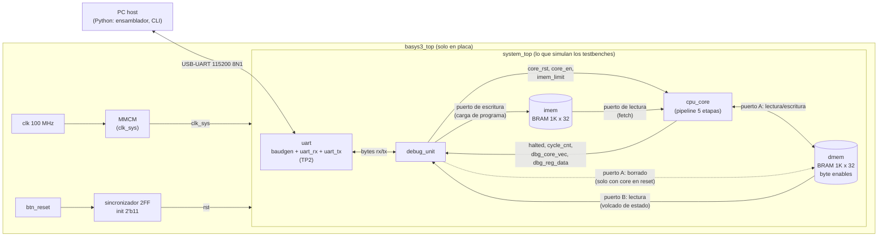
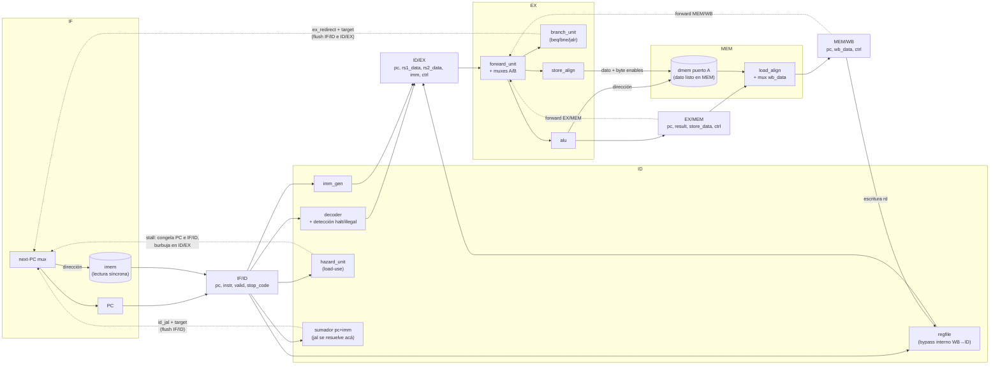

# TP3 Arquitectura de computadoras

- Nou, Sol Agustina - sol.nou@mi.unc.edu.ar

- Pillichody, Felipe - felipe.pillichody@mi.unc.edu.ar

## Objetivos

El sistema deberá implementar y permitir la interacción con un procesador RISC-V segmentado mediante un pipeline de cinco etapas. Para ello, deberá incorporar una unidad de depuración (Debug Unit) que permita controlar la ejecución del procesador e intercambiar información con una computadora mediante comunicación UART.

Asimismo, deberá proporcionar una interfaz de usuario que permita programar el procesador, controlar su ejecución y visualizar su estado interno. Esta interfaz podrá implementarse como una interfaz gráfica (GUI), de línea de comandos (CLI) o de terminal (TUI).

El procesador deberá admitir la ejecución de instrucciones pertenecientes a los formatos R-Type, I-Type y J-Type.

### Requerimientos

**Requerimientos funcionales**

**RF-01.** Programación del procesador: El sistema deberá permitir cargar programas en el procesador mediante comandos enviados desde una computadora a través de una interfaz de comunicación UART.

**RF-02.** Reprogramación dinámica: El sistema deberá permitir modificar y volver a cargar el programa del procesador sin requerir una nueva configuración o programación de la FPGA.

**RF-03**. Lenguaje de programación: El sistema deberá admitir programas escritos en lenguaje ensamblador.

**RF-04.** Traducción a lenguaje máquina: El sistema deberá incorporar un mecanismo de traducción de instrucciones en lenguaje ensamblador a su correspondiente representación en lenguaje máquina, para su posterior carga en el procesador.

**RF-05**. Finalización de ejecución: El sistema deberá implementar una instrucción HALT que permita detener la ejecución del programa.

**RF-06**. Modos de ejecución: El sistema deberá permitir seleccionar entre dos modos de operación: ejecución continua y ejecución paso a paso.

**RF-07.** Ejecución continua: En este modo, el sistema deberá iniciar la ejecución del programa al recibir un comando desde la computadora a través de UART y continuar hasta alcanzar la instrucción HALT. Una vez finalizada la ejecución, deberá transmitir a la computadora la información correspondiente al estado del procesador.

**RF-08**. Ejecución paso a paso: En este modo, el sistema deberá ejecutar un ciclo de reloj por cada comando de avance recibido a través de UART. Luego de cada ciclo, deberá transmitir a la computadora la información correspondiente al estado actualizado del procesador.

**RF-09**. Consulta de registros: El sistema deberá permitir obtener y transmitir a la computadora el contenido de los 32 registros de propósito general del procesador.

**RF-10.** Consulta de pipeline: El sistema deberá permitir obtener y transmitir a la computadora el contenido de los registros intermedios (pipeline registers/latches) que almacenan información entre las distintas etapas del pipeline.

**RF-11**. Consulta de memoria de datos: El sistema deberá permitir obtener y transmitir a la computadora el contenido de las posiciones utilizadas de la memoria de datos.

**RF-12**. Visualización del estado: La interfaz de usuario deberá presentar la información recibida desde la FPGA, incluyendo los registros de propósito general, los registros intermedios del pipeline y la memoria de datos utilizada.

**Requerimientos no funcionales**

**RNF-01**. Interfaz de comunicación: La comunicación entre la computadora y la FPGA deberá realizarse mediante el protocolo UART.

**RNF-02.** Integridad del reloj: El diseño deberá garantizar que la señal de reloj del sistema no sea modificada, interrumpida ni intervenida por los mecanismos de depuración o comunicación.

**RNF-03**. Interfaz de usuario: La interacción con el sistema deberá realizarse mediante una interfaz GUI, CLI o TUI.

# Desarrollo

El Pipeline es una técnica de implementación de microprocesadores que permite solapar la ejecución de múltiples instrucciones. es posible iniciar la ejecución de una nueva instrucción en cada ciclo de reloj, siempre que no existan riesgos. Esto implica, mientras una instrucción se encuentra en una etapa, las demás etapas del procesador pueden trabajar sobre otras instrucciones.

Cada etapa del pipeline se encarga de ejecutar una parte especifica del procesamiento de una instruccion. Para que esto sea posible, se incorporan buffer entre las etapas que puedan mantener las entradas de cada etapa en un ciclo de reloj y las actualizan con las salidas generadas por la etapa anterior al comienzo del siguiente ciclo.

## Guía de lectura del informe y del código

El informe sigue el orden lógico del desarrollo de los módulos, y cada sección se puede leer junto con el archivo Verilog que la implementa (carpeta `TP3/src/`). 

La convención del código es un módulo por archivo, Verilog-2001, reset síncrono activo en alto y, en todo elemento secuencial del core, la forma `if (rst) ... else if (en)`. El comentario de cabecera de cada archivo resume la decisión que implementa.

### Dónde se resuelve cada requerimiento

| Requerimiento | Cómo se resuelve | Sección del informe | Código |
| --- | --- | --- | --- |
| RF-01 Programación por UART | Comando LOAD: con el core en reset, la Debug Unit escribe el programa en la memoria de instrucciones | Debug unit, Protocolo | `dbg_ctrl.v`, `dbg_rx_frame.v`, `imem.v` |
| RF-02 Reprogramación dinámica | Cada LOAD reinicia el core y sobrescribe el programa, sin reconfigurar la FPGA | Debug unit, Preguntas | `dbg_ctrl.v` |
| RF-03 Programas en ensamblador | Sintaxis RV32I con etiquetas y pseudoinstrucciones | Interfaz CLI | `assembler.py` |
| RF-04 Traducción a lenguaje máquina | Ensamblador de dos pasadas con salida `.hex`, `.bin` y `.coe`; el `.bin` es el payload del LOAD | Interfaz CLI | `assembler.py`, `isa.py` |
| RF-05 Instrucción HALT | `ebreak` como marcador que recorre el pipeline hasta WB | 1.3 Instrucciones, Modos de operación | `decoder.v`, `halt_ctrl.v` |
| RF-06 Modos de ejecución | Un único hardware; los modos se diferencian por cómo se genera `core_en` | Modos de operación | `dbg_ctrl.v`, `cpu_core.v` |
| RF-07 Ejecución continua | `RUN`: `running = 1` hasta que el core levanta `halted`, y respuesta con el volcado final | Modos de operación | `dbg_ctrl.v` (`S_RUN`), `halt_ctrl.v` |
| RF-08 Ejecución paso a paso | `STEP`: `step_pulse` de un ciclo y un volcado por cada paso | Modos de operación | `dbg_ctrl.v` (`S_STEP`), `cpu_core.v` (`en_int`) |
| RF-09 Consulta de registros | Volcado de los 32 registros mediante un puerto de lectura de debug del banco | Protocolo | `regfile.v`, `dbg_state_src.v` |
| RF-10 Consulta del pipeline | `dbg_core_vec` concatena el PC y los cuatro registros de pipeline | Protocolo, 2. Pipeline | `cpu_core.v`, `dbg_state_src.v` |
| RF-11 Consulta de memoria de datos | Puerto B de solo lectura de la dmem; se vuelcan solo las palabras usadas (`dmem_used`) | Protocolo | `dmem.v`, `dbg_ctrl.v` |
| RF-12 Visualización del estado | La CLI decodifica el volcado y muestra registros, etapas del pipeline y memoria, resaltando los cambios | Interfaz CLI | `cli.py`, `protocol.py` |
| RNF-01 Comunicación UART | UART de TP2 a 115200 baudios, 8N1, con tramas con checksum | Debug unit, Protocolo | `uart*.v`, `dbg_rx_frame.v`, `dbg_tx_frame.v` |
| RNF-02 Integridad del reloj | Enable global sobre los pines CE en lugar de *gating*; el MMCM solo genera la frecuencia | Modos de operación, Análisis temporal | `cpu_core.v` (`en_int`), `basys3_top.v` |
| RNF-03 Interfaz de usuario | CLI en Python | Interfaz CLI | `cli.py` |


## 1. Arquitectura propuesta

Antes de diseñar el pipeline se definió el sistema completo y sus fronteras: qué es del procesador, qué de la Debug Unit y qué de la placa. El requerimiento principal es que **todo corre en un único dominio de reloj**; el MMCM existe solo en `basys3_top.v` y todo lo que está debajo (`system_top.v`) se simula con un reloj de testbench, sin modelos de IP de Xilinx. **Código:** `basys3_top.v` y `system_top.v`.



Diagrama del pipeline



Detalle clave del diagrama: las BRAM se direccionan un ciclo antes de la etapa que consume el dato (secciones 2.1 y 2.4). imem recibe next\_pc y entrega la instrucción alineada con PC durante IF; dmem recibe la dirección calculada en EX y entrega el dato durante MEM. Así los cuatro registros de pipeline son flip-flops explícitos.

### 1.1 Parámetros principales

| Parámetro | Valor | Comentario |
| --- | --- | --- |
| `XLEN` | 32 | RV32I |
| `IMEM_ADDR_W` | 10 | 1024 palabras = 4 KiB = 1 RAMB36 |
| `DMEM_ADDR_W` | 10 | 1024 palabras = 4 KiB = 1 RAMB36 |
| `CLK_FREQ_HZ` | 100 000 000 | Valor por defecto en simulación; en la placa, `basys3_top` le pasa la frecuencia del MMCM (94 444 444) |
| `BAUD` | 115 200 | 8N1, igual que en el TP2 |
| `MAX_CYCLES` | 1 000 000 | Límite de ciclos desde el reset (TIMEOUT, sección 6.3) |

El Artix-7 35T tiene 50 bloques RAMB36, así que ambas memorias se pueden agrandar cambiando un parámetro; 4 KiB alcanza para los programas de prueba y mantiene corto el volcado de memoria.

### 1.2 Mapa de memoria

Se decidio utilizar una arquitectura Harvard con dos espacios de direcciones independientes, ambos empezando en 0.  Los bits de dirección por encima del tamaño de cada memoria se ignoran (aliasing): con 4 KiB, la dirección de datos `0x1000` es la misma palabra que `0x0000`.

**1.2.1 ACCESOS DESALINEADOS**

La memoria de datos se organiza en palabras de 32 bits (4 bytes). Por lo tanto, las direcciones alineadas a palabra en este procesador son aquellas que son múltiplos de 4 (0x00, 0x04, 0x08, etc.). De manera equivalente, una dirección está alineada a media palabra (16 bits) cuando es múltiplo de 2.

El acceso a memoria puede realizarse sobre distintas cantidades de bytes, según la instrucción utilizada: las instrucciones lb, lbu y sb acceden a un byte; lh, lhu y sh a dos bytes; y lw y sw a cuatro bytes.

En la implementacion el hardware ajusta la direccion de accesos desalineados para utilizar la posicion alineada correspondiente, de acuerdo con el tamaño del dato:

- **Accesos a palabra (`lw` y `sw`):** se ignoran los dos bits menos significativos de la dirección (`addr[1:0]`). De esta manera, se accede a la palabra que comienza en la dirección obtenida al aplicar `addr & ~3`. Por ejemplo, un acceso a la dirección `0x02` se realiza sobre la palabra que comienza en `0x00`.
- **Accesos a media palabra (`lh`, `lhu` y `sh`):** se ignora el bit menos significativo de la dirección (`addr[0]`), mientras que `addr[1]` se conserva para seleccionar cuál de las dos mitades de la palabra se utiliza. Por ejemplo, tanto una dirección `0x02` como una `0x03` acceden a los dos bytes que comienzan en `0x02`.
- **Accesos a byte (`lb`, `lbu` y `sb`):** no requieren alineación, ya que pueden acceder directamente a cualquier dirección de memoria. Por lo tanto, se utiliza la dirección calculada sin modificaciones.

Para la búsqueda de instrucciones, la memoria de instrucciones también se organiza en palabras de 32 bits. En consecuencia, se ignoran los dos bits menos significativos del PC para realizar la lectura, utilizando la dirección `PC & ~3`. Sin embargo, el valor del PC conserva sus bits originales, es decir, no se modifica al valor al que fue alineado.

Por otra parte, la instrucción `jalr` pone en cero el bit menos significativo de la dirección de destino (`PC[0]`), tal como establece la especificación de RISC-V. No obstante, el bit `PC[1]` puede permanecer en uno si el programa calcula un destino que no está alineado a palabra. En ese caso, se aplica el comportamiento de *fetch* descripto anteriormente.

### 1.3 Instrucciones y decodificacion

En esta seccion se detallan las decisiones en cuanto a las instrucciones y decodificaciones.

Se implementa un subconjunto de RV32I, suficiente para los tipos R, I y J que pide la consigna: aritmético-lógicas entre registros (`add`, `sub`, `sll`, `slt`, `sltu`, `xor`, `srl`, `sra`, `or`, `and`) y con inmediato (`addi`, `slti`, `sltiu`, `xori`, `ori`, `andi`, `slli`, `srli`, `srai`), cargas (`lb`, `lh`, `lw`, `lbu`, `lhu`), almacenamientos (`sb`, `sh`, `sw`), saltos condicionales (`beq`, `bne`), saltos incondicionales (`jal`, `jalr`), `lui` y `ebreak`.&#32;

Quedan fuera `blt` y similares, `auipc` y las instrucciones de sistema distintas de `ebreak`. **Código:** `decoder.v` define el subconjunto, y `imm_gen.v` y `alu.v` lo ejecutan.

**1.3.1 HALT**

Para el HALT, se utilizó ebreak (0x00100073), siendoo esta una instruccion estandar de RV32I que ensambladores existentes ya reconocen y su semtantica real “detener y ceder el control al depurador” es la necesidad que habia que satisfacer. Un opcode custom obliga a parchear cualquier herramienta externa; jal x0, 0 mezcla un HALT con un salto legal.

**1.3.2 INSTRUCCIONES ILEGALES**

Se tomó la decision de diseño que toda instruccion fuera del subconjunto va a tratarse como un HALT, indicando en halt\_reason = ILLEGAL para dejar de buscar instrucciones, drenar el pipeline y reportar el PC de la isntruccion ilegal.

La decodificación es estricta:

- opcode \[1:0\] debe ser 11;
- opcodes válidos: OP, OP-IMM, LOAD, STORE, BRANCH, JAL, JALR, LUI, SYSTEM;
- OP: funct7 = 0000000, o 0100000 solo con funct3 000 (sub) o 101 (sra);
- OP-IMM shifts: funct7 = 0000000 (slli, srli) o 0100000 (srai); imm\[5\] (bit 25) en 1 es ilegal en RV32I;
- LOAD funct3 ∈ {000, 001, 010, 100, 101}; STORE funct3 ∈ {000, 001, 010};
- BRANCH funct3 ∈ {000, 001} (blt y similares no están en el subconjunto);
- JALR funct3 = 000;
- SYSTEM: solo 0x00100073 exacto (ecall = ilegal).

Un detalle importante es que una instrucción ilegal en el camino equivocado (después de un salto tomado) no detiene nada, porque se descarta antes de aceptarse.

### 1.4 Módulos

El trabajo está implementado en `TP3/``src``/` donde podemos encotnrar el core, los submodulos, memorias, UART, Debug Unit, system\_top y basys3\_top.

La jerarquía de archivos del proyecto es:&#32;

```
basys3_top                      (solo placa: MMCM, sincronizador de reset, pines)
└── system_top                  (tope de los testbenches de sistema)
    ├── uart                    (TP2, sin cambios)
    │   ├── uart_baudgen
    │   ├── uart_rx
    │   └── uart_tx
    ├── debug_unit
    │   ├── dbg_rx_frame        (parser de tramas, checksum, timeout entre bytes)
    │   ├── dbg_tx_frame        (armado de tramas de respuesta)
    │   ├── dbg_state_src       (genera los bytes del volcado de estado)
    │   └── dbg_ctrl            (FSM de comandos)
    ├── cpu_core
    │   ├── fetch_unit          (PC + mux de next_pc + stop_code)
    │   ├── if_id_reg
    │   ├── decoder
    │   ├── imm_gen
    │   ├── regfile
    │   ├── hazard_unit
    │   ├── id_ex_reg
    │   ├── forward_unit
    │   ├── alu
    │   ├── branch_unit
    │   ├── store_align
    │   ├── ex_mem_reg
    │   ├── load_align
    │   ├── mem_wb_reg
    │   └── halt_ctrl           (halting/halted/motivo + cycle_cnt/timeout)
    ├── imem                    (BRAM inferida, simple dual port)
    └── dmem                    (BRAM inferida, true dual port, B solo lectura)

```

Las memorias quedan **fuera** de `cpu_core`. Así los tests a nivel CPU (`tb_cpu_core`, `tb_cpu_step`) instancian `cpu_core + imem + dmem` y cargan los programas por el puerto de escritura de imem, sin UART. El mux del puerto A de dmem (core o borrado de la Debug Unit) es un `assign` en `system_top`.

## 2. Pipeline

Describimos cuales son las 5 etapas del pipeline implementado:

En `cpu_core.v` las etapas aparecen en este mismo orden, separadas por comentarios, y entre cada par hay un registro de pipeline. El control de cada instrucción viaja empaquetado en un vector (`id_ex_ctrl`, `ex_mem_ctrl`, `mem_wb_ctrl`) con el mismo formato que el volcado de estado, de modo que `dbg_core_vec` es una simple concatenación de esos registros y el formato se define en un solo lugar. Para cada etapa se indica qué módulos la forman.

**Registros de pipeline.** Un registro de pipeline es un conjunto de flip-flops ubicado entre dos etapas: en cada flanco captura lo que calculó la etapa anterior y lo mantiene estable durante el ciclo siguiente, de modo que cada etapa trabaja sobre una instrucción distinta. 
Se decidió implementarlos como módulos explícitos (`if_id_reg`, `id_ex_reg`, `ex_mem_reg` y `mem_wb_reg`), para que la Debug Unit pueda leerlos y para concentrar en ellos el control del flujo de instrucciones. Todos siguen el mismo patrón, con prioridad `rst` > `en` > `flush` > `hold`. El reset y el flush cargan una burbuja, es decir, una instrucción sin efectos con `valid = 0`. Con `en = 0` o `hold = 1` no se asigna nada y el registro conserva su valor, algo que en la FPGA se implementa con el pin CE del flip-flop. Solo IF/ID tiene `hold`, y solo IF/ID e ID/EX tienen `flush`, porque una instrucción que ya llegó a EX/MEM nunca se cancela. El vector de control se achica de una etapa a la siguiente (31, 13 y 9 bits), ya que cada etapa deja de propagar las señales que ya consumió.

### 2.1 Instruction Fetch

En la etapa IF se utiliza el valor indicado por el PC para acceder a la memoria de instrucciones y buscar proxíma a ejecutar. Antes de irse, se actualiza el PC a la próxima dirección de instrucción a ejecutar.

En `cpu_core.v` corresponde al bloque `IF` (instancias `u_fetch` y `u_if_id`). Los módulos que conforman esta etapa son:

- `fetch_unit`: contiene el PC y el multiplexor de `next_pc`, que elige entre `PC + 4`, el destino de un salto resuelto en EX, el destino de un `jal` resuelto en ID, o mantener el PC (stall, drenaje o pausa), con la prioridad descripta en la sección de riesgos. También marca la instrucción buscada con un `stop_code` cuando el PC sale del programa cargado (OOR) o se alcanzó el límite de ciclos (TIMEOUT).
- `imem`: memoria de instrucciones, una BRAM inferida de 1024 × 32 bits con lectura síncrona. Se direcciona con `next_pc` para que el dato llegue alineado con el PC durante IF. El puerto de escritura es exclusivo de la Debug Unit.
- `if_id_reg`: registro IF/ID con `pc`, `instr`, `stop_code` y `valid`. Ante un flush carga una burbuja (una NOP con `valid = 0`) y ante un load-use mantiene su contenido.

**Latencia de la memoria de instrucciones.** Las BRAM de la FPGA tienen lectura síncrona: el dato aparece un flanco después de presentar la dirección. Si la imem se direccionara con el PC, la instrucción llegaría un ciclo atrasada respecto de su PC. Por eso se decidió direccionarla con `next_pc`, la dirección que el PC tomará en el próximo flanco. Así el PC y el registro de salida de la BRAM se actualizan en el mismo flanco con la misma dirección, y durante todo el ciclo `imem_rdata` es la instrucción ubicada en `PC`. Por esta razón `rst` y `!en` también forman parte del multiplexor de `next_pc`: durante un reset, una pausa o un stall, la BRAM lee la dirección que corresponde y la instrucción en IF no se desfasa. El costo es que, ante un salto tomado, el destino calculado en EX debe atravesar el multiplexor y llegar a la dirección de la BRAM en el mismo ciclo, lo que define el camino crítico (sección 9.6).

### 2.2 Instruction Decode (ID)

En esta estapa, la instruccion entregada es decodificada para entender que se va a realizar, gracias al codigo de operacion y de funcion y preprara la informacion necesaria como los registros implicados y valores inmediatos.

A partir de la de decodificacion, genera señales de control para guiar la ejecuccion en el resto de etapas.

En `cpu_core.v` corresponde al bloque `ID` (instancias `u_dec`, `u_imm`, `u_rf`, `u_hz` y `u_id_ex`). Los módulos que conforman esta etapa son:

- `decoder`: decodificación estricta de la instrucción. Genera las señales de control, los registros fuente efectivos (en 0 si la instrucción no los usa) y la condición de detención (`ebreak`, instrucción ilegal o `stop_code`), que anula el resto del control.
- `imm_gen`: construye el inmediato de 32 bits con extensión de signo para los formatos I, S, B, U y J.
- `regfile`: banco de 31 registros en flip-flops (x0 está cableado a cero), con dos puertos de lectura asíncronos y *bypass* interno de la escritura de WB, y un tercer puerto de lectura para la Debug Unit.
- `hazard_unit`: detecta el riesgo load-use y genera el stall de un ciclo.
- Sumador de `jal`: calcula `pc + imm_J` para resolver el `jal` en esta etapa (está en `cpu_core`, no tiene módulo propio).
- `id_ex_reg`: registro ID/EX con `pc`, los dos operandos leídos, el inmediato y las señales de control empaquetadas en 31 bits. Se vacía ante un salto tomado, un load-use o una burbuja en ID.

**2.2.1 Señales de control**

El decoder analiza la instruccion recibida y genera un conjunto de señales de control que indican qué operación debe realizar el procesador y comó deben comportarse sus distitnas unidades. Entre estas señales se encuentran los registros que utiliza la instuccion, la operacion que debe ejecutar la ALU, el acceso a memoria y la escritura del resultado en el banco de registros.

Las señales generadas son:

| Señal | Ancho | Descripción |
| --- | --- | --- |
| `rs1`, `rs2` | 5 bits cada una | Identifican los registros fuente que utiliza la instrucción. Si no utiliza alguno, se fuerza su valor a cero. |
| `rd` | 5 bits | Identifica el registro destino donde se escribirá el resultado. Si la instrucción no escribe en un registro, vale cero. |
| `alu_op` | 4 bits | Determina la operación que debe realizar la ALU. Se obtiene combinando `alt` y `funct3`. *Revisar Tabla 1* |
| `alu_src` | 1 bit | Selecciona el segundo operando de la ALU: `0` para el valor de `rs2` y `1` para el inmediato. |
| `link` | 1 bit | Indica que el resultado que debe escribirse en `rd` es `PC + 4`. Se utiliza en `jal` y `jalr`. |
| `reg_write` | 1 bit | Habilita la escritura del resultado en el registro destino durante la etapa WB. |
| `mem_read` | 1 bit | Indica que la instrucción debe leer un dato de memoria (load). |
| `mem_write` | 1 bit | Indica que la instrucción debe escribir un dato en memoria (store). |
| `funct3` | 3 bits | Identifica características de la operación. En loads y stores determina el tamaño y el tratamiento del signo; en branches permite distinguir `beq` de `bne`. |
| `branch` | 1 bit | Identifica las instrucciones condicionales `beq` y `bne`, cuyo salto se resuelve en EX. |
| `jalr` | 1 bit | Identifica la instrucción `jalr`, cuyo salto se resuelve en EX. |
| `jal` | 1 bit | Identifica la instrucción `jal`, cuyo salto se resuelve en ID y, por lo tanto, no necesita viajar hasta EX. |
| `imm_sel` | 3 bits | Indica el formato del inmediato que debe generar el procesador: I, S, B, U o J. |
| `is_ebreak` | 1 bit | Identifica la instrucción `ebreak`, utilizada como mecanismo de finalización del programa. |
| `illegal` | 1 bit | Indica que la instrucción recibida no corresponde a una instrucción válida o soportada. |

**Codificación de las operaciones de la ALU**

La señal alu\_op se a partir del campo `funct3` que identifica el tipo de operación y el campo `alt` que permite distinguir operaciones que comparten el mismo valor de `funct3`, como `add` y `sub`, o `srl` y `sra`.

La señal se contruye:

`alu_op = {alt, funct3}`

| op | add | sub | sll | slt | sltu | xor | srl | sra | or | and |
| --- | --- | --- | --- | --- | --- | --- | --- | --- | --- | --- |
| `alu_op` | 0000 | 1000 | 0001 | 0010 | 0011 | 0100 | 0101 | 1101 | 0110 | 0111 |

`alt` se obtiene de `instr[30]` únicamente para las instrucciones de tipo OP y para las instrucciones OP-IMM con `funct3 = 101` (desplazamientos a derecha srli y srai). En otros casos, ese bit no debe interpretarse como parte de la operación, ya que puede pertenecer a otro campo de la instrucción. Por ejemplo, en addi, el bit 30 forma parte del inmediato y se ignora para determinar la operación de la ALU.

Las instrucciones de carga, almacenamiento, `jalr` y `lui` utilizan la operación `add` de la ALU, ya que necesitan realizar una suma para calcular una dirección o construir el resultado.

Por último, en las operaciones de desplazamiento, la cantidad de posiciones a desplazar se obtiene de los cinco bits menos significativos del segundo operando (`b[4:0]`).

### 2.3 Execute (EX)

En esta etapa se realizan los calculos requeridos por las instruccion y se almacenan los resultados en el registro EX\_MEM para las etapas posteriores y completar la ejecucion

En `cpu_core.v` corresponde al bloque `EX` (instancias `u_fwd`, `u_alu`, `u_br`, `u_st` y `u_ex_mem`). Los módulos que conforman esta etapa son:

- `forward_unit`: compara los registros fuente de la instrucción en EX con los destinos de EX/MEM y MEM/WB y genera la selección de los multiplexores de operandos (banco, EX/MEM o MEM/WB), dando prioridad al resultado más reciente.
- `alu`: unidad aritmético-lógica combinacional de 32 bits (suma, resta, desplazamientos, comparaciones, XOR, OR y AND), sin flags. También calcula las direcciones de loads y stores y el destino de `jalr`.
- `branch_unit`: comparador de igualdad dedicado que, en paralelo con la ALU, decide si `beq`/`bne` se toma y calcula el destino (`pc + imm`, o `rs1 + imm` con el bit 0 en cero para `jalr`). Genera `ex_redirect`.
- `store_align`: replica el dato a escribir en los carriles de bytes y genera los *byte enables* para `sb`, `sh` y `sw`.
- `ex_mem_reg`: registro EX/MEM con `pc`, resultado, dato del store y control. Solo lo afectan el reset y el enable global, porque ninguna instrucción en esta etapa se cancela.

### 2.4 Memory Access (MEM)

Con la direccion efectiva calculada se accede a la memoria para hacer la lectura o escritura si es una instruccion en la que aplique (S o L)

En `cpu_core.v` corresponde al bloque `MEM` (instancias `u_ld` y `u_mem_wb`); la `dmem` está fuera del core, en `system_top.v`. Los módulos que conforman esta etapa son:

- `dmem`: memoria de datos, una BRAM inferida de 1024 × 32 bits con *byte enables*. El puerto A es del core y se direcciona desde EX, de modo que el dato de un load está listo durante MEM; el puerto B es de solo lectura y lo usa la Debug Unit para el volcado sin interferir con el pipeline.
- `load_align`: selecciona el byte o la media palabra pedida según `addr[1:0]` y la extiende con signo o con ceros (`lb`, `lbu`, `lh`, `lhu`, `lw`).
- Multiplexor de `wb_data`: elige entre el dato cargado (loads) y el resultado de EX.
- `mem_wb_reg`: registro MEM/WB con `pc`, el dato a escribir y el control.

**Latencia de la memoria de datos.** Se aplicó el mismo criterio que en la imem: la dirección se calcula en EX y se presenta a la dmem en ese mismo ciclo. De esta forma el store se escribe en el flanco EX→MEM y el dato de un load queda disponible durante MEM, sin agregar ciclos. Las escrituras parciales (`sb`, `sh`) usan *byte enables*: `store_align` replica el dato en los carriles de bytes y activa solo los que corresponden según `addr[1:0]`. En la lectura, `load_align` extrae el byte o la media palabra y la extiende con signo o con ceros. El enable `a_en = en_int` congela tanto la escritura como el registro de salida, así que durante una pausa el dato de un load que está en MEM no cambia.

Escribir el store al final de EX y no al final de MEM es seguro porque una instrucción que llegó a EX nunca se cancela: los flush solo descartan instrucciones más jóvenes (en IF e ID), el HALT deja terminar a las más viejas y el stall de load-use inserta la burbuja en ID/EX sin tocar EX.

**Memoria inferida y no IP.** Las dos memorias se describen en Verilog con las plantillas de BRAM de Xilinx (UG901) en lugar de usar el Block Memory Generator. Así se simulan sin modelos de IP, son parametrizables (`ADDR_W`), se inicializan con `$readmemh` y no agregan al repositorio archivos que dependan de la versión de Vivado. En el reporte de utilización se confirmó que Vivado infirió dos `RAMB36E1` y ninguna LUTRAM. Se descartó la LUTRAM de lectura asíncrona, que permitiría un pipeline "de libro" sin pensar en la latencia, porque 2 × 4 KiB consumirían unas 1000 LUTs más multiplexores y serían más lentas a este tamaño.

### 2.5 Write Back (WB)

Se escribe el resultado en los registros corresponeidnte, tomando el valor segun la isntruccion que se ejcuto. Esto es controlado por un multiplexor que selecciona que valor va a ser el almacenado en el registro de destino. Se realiza trabajo en esta etapa solametne para instrucciones R o L, las demas es un ciclo sin trabajo.

En `cpu_core.v` corresponde al bloque `WB` (el puerto de escritura de `u_rf` y la instancia `u_halt`). Los módulos que conforman esta etapa son:

- Puerto de escritura de `regfile`: escribe `wb_data` en `rd` cuando `reg_write = 1` y `rd != 0`.
- `halt_ctrl`: observa el marcador HALT que sale de MEM/WB, levanta `halted` y vacía el estado de drenaje. Además lleva el motivo de detención y el contador de ciclos `cycle_cnt` que dispara el TIMEOUT.

## 3. Riesgos

´Para detectar y eliminar los riesgos se agregan distintos modulos.

### 3.1 Forwarding

El forwarding es una técnica utilizada para resolver riesgos de datos que aparecen cuando una instrucción necesita un resultado que fue calculado por una instrucción anterior, pero que todavía no fue escrito en el banco de registros. Como varias instrucciones se ejecutan simultáneamente en las distintas etapas del pipeline, puede ocurrir que una instrucción intente leer un registro antes de que se haya actualizado su valor.

Para evitar que se utilice un dato desactualizado, se realiza un cortocircuito realizando un camino sadicional que permita enviar directamente el resultado de la ALU desde etapas posteriores del pipeline hacia los operandos de la ALU que esté en EX, sin necesidad de esperar a que se complete la escritura en el banco de registros.

La unidad de forwarding compara los registros fuente (`rs1` y `rs2`) de la instrucción que se encuentra en EX con los registros destino (`rd`) de las instrucciones que están en las etapas posteriores. Si detecta una dependencia, selecciona el dato más reciente disponible, siguiendo este orden de prioridad:

- **EX/MEM:** si hay una instrucción en EX cuyo registro fuente es el destino de una instrucción en MEM, se utiliza el resultado almacenado en `ex_mem.result`. Se excluyen las cargas, porque en esa etapa `ex_mem.result` contiene la dirección y no el dato: `ex_mem.reg_write && ex_mem.rd != 0 && ex_mem.rd == id_ex.rsX && !ex_mem.mem_read`;
- **MEM/WB**: si no existe una coincidencia válida en EX/MEM, se verifica si la instrucción en WB escribe el registro que necesita la instrucción actual. En ese caso, se utiliza el dato  (`mem_wb.wb_data`) si `mem_wb.reg_write && mem_wb.rd != 0 && mem_wb.rd == id_ex.rsX`;
- **Banco de registros:** si no detecta dependencias se utiliza el valor leído en ID  (`id_ex.rsX_data`).

La prioridad es importante porque, si varias instrucciones anteriores modificaron el mismo registro, debe utilizarse el resultado de la más reciente. El valor de `rs2` obtenido mediante este mecanismo también se utiliza como dato para las instrucciones de almacenamiento (*store*) y como entrada del comparador de saltos.

Por otra parte, para resolver las dependencias entre una escritura en WB y una lectura en ID que ocurren durante el mismo ciclo, el banco de registros incorpora un **bypass interno**. Si el registro que se está escribiendo coincide con alguno de los que se intenta leer, se devuelve directamente el nuevo dato en lugar del valor anterior almacenado.

Con estos mecanismos quedan cubiertas todas las distancias entre la instrucción que produce un dato y la que lo usa. A distancia 1 el dato se toma de EX/MEM, a distancia 2 de MEM/WB, a distancia 3 del *bypass* del banco, y a partir de 4 ya está escrito en el banco. Para evitar adelantamientos falsos, el decoder entrega como `rs1` y `rs2` solo los registros que la instrucción realmente lee y pone en 0 los demás. Por ejemplo, en `lui` los bits 19:15 pertenecen al inmediato; con `rs1 = 0`, la ALU calcula `0 + imm` aunque ese campo coincida con un `rd` anterior.

**Código:** `forward_unit.v` genera `fwd_a` y `fwd_b`; los multiplexores de operandos (`ex_op_a`, `ex_op_b`) están en `cpu_core.v`; el *bypass* WB→ID está en `regfile.v` (`bypass1`, `bypass2`).

### 3.2 Hazard Unit

El riesgo load-use aparece cuando una instrucción necesita utilizar el resultado de una instrucción anterior que todavía no completó su acceso a memoria (etapa MEM). En este caso, el forwarding no es suficiente para resolver la dependencia, porque es una dependencia temporal, no es posible adelantar un valor que aún no fue obtenido. Por este motivo, es necesario frenar el avance del pipeline durante un ciclo.

La unidad **Hazard** detecta estos casos durante la etapa ID, mediante la siguiente condición:

`load_use = if_id.valid && id_ex.mem_read && id_ex.rd != 0 && (id_ex.rd == id.rs1 || id_ex.rd == id.rs2)`

Cuando se detecta el riesgo, se congela el PC y el registro IF/ID, para que la misma instruccion permanezca en ID hasta el ciclo siguiente. Al mismo tiempo, se insertan señales de control en cero en ID/EX, generando una burbuja que evita que esa etapa avance o realice alguna operación. De esta manera, la instrucción load puede continuar avanzando por el pipeline y, un ciclo después, cuando se encuentra en WB, el dato ya está disponible para ser enviado mediante forwarding desde MEM/WB hacia EX.

El stall se diferencia de la pausa del modo paso a paso por su alcance. El stall congela solo el PC e IF/ID y deja avanzar al resto del pipeline, porque el load tiene que llegar a MEM para que el riesgo se resuelva. La pausa (`en = 0`), en cambio, congela todo el procesador. La detección es conservadora: un store que guarda el valor recién cargado (`lw x5` seguido de `sw x5`) también genera el stall, aunque el dato recién se necesite en MEM, porque no se implementó adelantamiento de MEM a MEM.

**Código:** `hazard_unit.v` solo genera `load_use`; sus efectos se ven en `if_id_reg.v` (`hold`), en `id_ex_reg.v` (`flush`, burbuja) y en `fetch_unit.v` (`next_pc = pc`).

### 3.3 Riesgo de control

Un **riesgo de control** aparece cuando una instrucción puede alterar el flujo secuencial de ejecución (saltos condicionales e incondicionales) y el procesador debe decidir qué instrucción buscar antes de conocer el resultado del salto: si se toma y cuál es su destino. Como el pipeline ya cargó las instrucciones siguientes, si la decisión fue errónea esas instrucciones no deben completarse y se descartan convirtiéndolas en burbujas (*flush*), lo que se traduce en ciclos perdidos, la penalidad del salto.

Para evitar estos riesgos, se decidió utilizar una predicción estática de salto no tomado: se asume que ningún salto se toma y se continúa buscando en el PC secuencial (`PC + 4`). Si un `beq`, `bne` o `jalr` se resuelve en EX y el salto se toma, se vacían IF/ID e ID/EX, con una penalidad de dos ciclos. El `jal`, en cambio, se resuelve en ID y, como siempre salta, siempre paga un ciclo.

La etapa de resolución se eligió según lo que necesita cada instrucción. El `jal` solo necesita `pc + imm`, que está disponible en ID y no depende de ningún registro, por lo que adelantarlo no introduce riesgos de datos y ahorra un ciclo. Resolver `beq` y `bne` en ID también ahorraría un ciclo, pero exigiría agregar forwarding hacia ID y un stall adicional cuando el salto depende de la instrucción inmediatamente anterior, además de poner el comparador en serie con la lectura del banco. Resolverlos en EX reutiliza el forwarding existente y no agrega stalls, a costa de un ciclo más de penalidad en los saltos tomados.

Se utilizó un comparador de igualdad dedicado en `branch_unit`, separado de la ALU, que opera en paralelo con ella sobre los operandos ya forwardeados, para que no ocurran riesgos de datos.

La dirección de destino se calcula con un sumador independiente de la ALU que permite calcular el nuevo PC en la etapa EX, tomando los valores del registro ID/EX para sumar`id_ex.pc + id_ex.imm` fuera del camino crítico. Para `jalr`, en cambio, se aprovecha el resultado de la ALU, que ya calcula `rs1 + imm`, y se obtiene la dirección de destino aplicando `(alu_result) & ~1`, lo que garantiza que el bit menos significativo sea cero.

Con estas penalidades, la cantidad de ciclos de un programa (desde el primer ciclo habilitado tras el reset hasta que se levanta `halted`) es:

```
ciclos = N + 4 + stalls_load_use + 2·(beq/bne tomados + jalr) + 1·jal
```

donde `N` es la cantidad dinámica de instrucciones ejecutadas, incluido el `ebreak`. Por ejemplo, `addi x1, x0, 5; ebreak` tarda 2 + 4 = 6 ciclos.

**Código:** `branch_unit.v` resuelve `beq`, `bne` y `jalr` en EX y genera `ex_redirect`; el `jal` se resuelve en `cpu_core.v` (`id_jal`, `id_jal_target`); el PC lo corrige `fetch_unit.v`.

### 3.4 Prioridades entre eventos en un mismo ciclo

Durante la ejecución del pipeline pueden presentarse distintos eventos que requieren modificar el comportamiento normal de las etapas, como reinicios, pausas, saltos, instrucciones HALT o dependencias de datos. Para evitar conflictos, se estableció un orden de prioridades que determina qué acción debe realizarse cuando se presentan uno o más eventos en un mismo ciclo.

| Prioridad | Evento | PC | IF/ID | ID/EX |
| --- | --- | --- | --- | --- |
| 1 | `rst` | 0 | burbuja | burbuja |
| 2 | `!en` (pausa/step) o `halted` | se mantiene | se mantiene | se mantiene |
| 3 | `ex_redirect` (salto tomado o jalr en EX) | destino EX | burbuja | burbuja |
| 4 | `halt_accept` (HALT aceptado en ID) | `if_id.pc` | burbuja | marcador HALT |
| 5 | `halting` (drenando) | se mantiene | burbuja | burbuja\* |
| 6 | `load_use` | se mantiene | se mantiene | burbuja |
| 7 | `id_jal` | destino jal | burbuja | se carga (jal) |
| 8 | normal | `pc+4` | `{PC, imem_dout}` | se carga\* |

La prioridad más alta corresponde al reset (`rst`), que va a reiniciar el PC a cero y genera burbujas en IF/ID e ID/EX. Luego se consideran las pausas (`!en`) y la señal `halted`, durante las cuales el estado del procesador se mantiene sin cambios. Un salto tomado en EX (`ex_redirect`) tiene prioridad sobre la aceptación de HALT en ID (`halt_accept`), el drenado del pipeline (`halting`), las dependencias Load-Use (`load_use`) y los saltos `jal` resueltos en ID (`id_jal`). Si no ocurre ninguno de estos eventos, el pipeline continúa normalmente, avanzando el PC y cargando las siguientes instrucciones.

Una decisión del diseño es el tratamiento de las **burbujas heredadas**. Cuando IF/ID contiene una burbuja (`if_id.valid = 0`), ID/EX también debe recibir una burbuja, en lugar de decodificar su contenido. Esto ocurre durante el drenado del pipeline y en el ciclo posterior a un flush de IF/ID. Para implementar esto, la señal de vaciado de ID/EX se define con la condición:

```
id_ex_flush = ex_redirect | load_use | !if_id.valid
```

**Código:** la tabla se lee directamente en el bloque `always @(*)` de `fetch_unit.v`, donde cada `else if` es una fila; el flush y el hold de los registros están en `if_id_reg.v` e `id_ex_reg.v`.

### 3.5 Riesgo estructural

Los riesgos estructurales aparecen cuando dos etapas del pipeline necesitan utilizar simultáneamente un mismo recurso de hardware y este no tiene capacidad suficiente para atender ambas operaciones.

Para evitar este problema, se implementó una arquitectura Harvard, con memorias de instrucciones y de datos separadas, cada una utilizando su propia memoria BRAM. De esta manera, la etapa IF puede buscar instrucciones mientras la etapa MEM accede a los datos, sin competir por una misma memoria.

Por otro lado, el banco de registros dispone de dos puertos de lectura y uno de escritura, permitiendo leer simultáneamente los dos operandos de una instrucción y realizar escrituras cuando corresponda. Además, cuenta con un puerto de lectura adicional destinado al sistema de debug.

Con esta organización, las distintas etapas disponen de recursos independientes y no necesitan competir por un mismo hardware, evitando la aparición de riesgos estructurales.

**Código:** `imem.v`, `dmem.v` y `regfile.v`, cada uno con sus puertos independientes.

4. ## Debug unit

Se pide una unidad de depuración conectada al procesador para facilitar su programación, depuración y ejecución. Es una máquina de estados que recibe comandos por UART y controla al core solo a través de dos señales (`core_rst` y `core_en`), más el largo del programa (`imem_limit`), de modo que el procesador no necesita saber que existe. El resto de la conexión es de solo lectura: un puerto de debug del banco de registros, el puerto B de la dmem y el vector `dbg_core_vec`. Las dos únicas escrituras que hace la Debug Unit, la carga de la imem y el borrado de la dmem, ocurren con el core en reset, por lo que la depuración nunca compite con el pipeline por un recurso.

Se dividió en cuatro módulos con una sola responsabilidad cada uno: el parser no conoce el significado de los comandos, el control no conoce el formato de las tramas y el armado de la respuesta no conoce su contenido. Esto permitió probar cada módulo con su propio testbench. **Código:** `debug_unit.v` es el tope que instancia los cuatro submódulos; conviene leer primero `dbg_ctrl.v`. Está formada por:

- **dbg\_rx\_frame**: máquina de estados que recorre la trama byte por byte (inicio, comando, largo, payload y checksum), acumula la suma de verificación y avisa a `dbg_ctrl` mediante pulsos de un ciclo. El encabezado se informa antes del payload para que el LOAD pueda escribir la imem a medida que llegan los bytes, sin un buffer para el programa completo. Si pasan 10 ms sin recibir un byte en medio de una trama, o llega un byte con error de *framing*, la descarta y vuelve a buscar el inicio, de modo que un byte perdido no deja al parser bloqueado.
- **dbg\_ctrl**: máquina de estados que interpreta los comandos. Antes de ejecutar valida, en orden, el checksum, el comando, el largo y el estado (programa cargado y core no detenido); una trama errónea nunca mueve al core y solo genera una respuesta de error. LOAD mantiene el core en reset mientras llega el programa y arma cada palabra de 32 bits a partir de cuatro bytes *little-endian*. LOAD, RESET y el reset de la placa terminan con una secuencia de reinicio que borra la dmem palabra por palabra y suelta el reset del core dos ciclos después; la respuesta se envía al final, cuando el core ya está listo. RUN y STEP se describen en Modos de operación.
- **dbg\_tx\_frame**: arma la trama de respuesta a partir del código y el largo que indica `dbg_ctrl`. Envía el inicio, el encabezado y el payload, que pide byte a byte a `dbg_state_src`, y calcula el checksum mientras transmite. Para cada byte espera que el transmisor UART esté libre, lo inicia, y espera que `tx_busy` suba y vuelva a bajar antes de continuar.
- **dbg\_state\_src**: traduce un índice de byte al dato correspondiente del volcado. Según el rango, lo toma del bloque de estado, de `dbg_core_vec`, del puerto de debug del banco de registros o del puerto B de la dmem. Responde con una latencia fija de tres ciclos, impuesta por la lectura síncrona de la BRAM. Como el core está congelado durante todo el envío, el volcado es una foto consistente de un único ciclo.

La comunicación usa los módulos UART del TP2 sin cambios, a 115200 baudios, 8N1. Se eligió esa velocidad porque con el divisor entero el error de baudios es de solo +0,47 %, muy por debajo del \~2 % tolerable; las tramas son cortas, así que una velocidad mayor no mejoraría de forma apreciable la experiencia de uso.

**Reuso de TPs anteriores.** Del TP2 se copiaron sin cambios los módulos `uart_baudgen`, `uart_rx`, `uart_tx` y `uart`, y se reutilizaron el patrón del sincronizador de reset, el manejo de `tx_busy` (que sube un ciclo después de `tx_start`), la base en `pyserial` de los scripts de Python y las constraints de la Basys 3 (reloj, botón, UART y LEDs, sin cambiar pines). La ALU del TP1 no se reutilizó tal cual, porque es de 8 bits, registra sus operandos internamente, usa códigos de operación estilo MIPS y le faltan `sll`, `slt` y `sltu`; se tomó la idea (un `case` por operación y `$signed` para `sra`) en una ALU combinacional nueva de 32 bits.

5. ## Protocolo

Todas las tramas tienen el mismo formato, `SOF | CMD | LEN | PAYLOAD | CHK`, con los campos multibyte en *little-endian* (igual que RISC-V). El `SOF` es `0xA5` en los pedidos y `0x5A` en las respuestas, y el checksum es el complemento a dos de la suma de 8 bits de todo lo que sigue al `SOF`, de modo que el receptor solo verifica que la suma total dé cero. Usar un único formato permite un solo parser en hardware, y el campo `LEN` hace que un comando desconocido pueda saltearse sin perder el sincronismo. El intercambio es *stop-and-wait*: el host envía un pedido y espera la respuesta antes del siguiente. Un checksum simple alcanza porque en un enlace USB-UART el riesgo real es perder bytes, algo que ya cubren `LEN` y el timeout entre bytes, y no un bit alterado.

| CMD | Comando | Función |
| --- | --- | --- |
| `0x01` | LOAD | Escribe el programa en la memoria de instrucciones y hace un reset completo |
| `0x02` | RESET | Reinicia la ejecución sin tocar el programa |
| `0x03` | RUN | Ejecuta en modo continuo y responde al terminar, con el estado final |
| `0x04` | STEP | Avanza exactamente un ciclo de reloj y responde con el estado |
| `0x05` | DUMP | Devuelve el estado sin avanzar |

Las respuestas de RUN, STEP y DUMP llevan el volcado de estado (`204 + 4·dmem_used` bytes): flags y motivo de detención, cantidad de ciclos, PC y los cuatro registros de pipeline (IF/ID, ID/EX, EX/MEM y MEM/WB), los 32 registros y las palabras usadas de la memoria de datos. Como "memoria usada" se tomó el *high-water mark* de escritura: un único registro con un comparador que mantiene la mayor palabra escrita, de modo que el volcado es un bloque contiguo sin direcciones.

Toda trama completa y bien formada recibe exactamente una respuesta. Un pedido que llega mientras la Debug Unit está ocupada (incluido un RUN en curso) se descarta sin respuesta, y las tramas incompletas o con error de *framing* se descartan en silencio; el host las detecta por su propio timeout. Las respuestas de error llevan como payload un byte con el `CMD` del pedido que las causó:

| Respuesta | Nombre | Causa |
| --- | --- | --- |
| `0xE1` | `ERR_CHECKSUM` | El checksum del pedido no da 0 |
| `0xE2` | `ERR_UNKNOWN_CMD` | `CMD` no definido |
| `0xE3` | `ERR_LENGTH` | `LEN` inválido para el comando |
| `0xE4` | `ERR_HALTED` | STEP o RUN con el core ya detenido (hace falta RESET o LOAD) |
| `0xE5` | `ERR_NO_PROGRAM` | STEP o RUN sin un LOAD válido |

Como referencia de tiempos a 115200 baudios (\~11,5 KB/s): un STEP sin memoria usada tarda unos 19 ms, uno con 64 palabras usadas unos 41 ms, y un LOAD de 1024 palabras o un volcado con la dmem completa unos 0,36 s.

6. ## Modos de operación

La consigna exige dos modos: **continuo** (un comando inicia la ejecución hasta el final del programa) y **paso a paso** (un comando ejecuta un ciclo de reloj). Se resolvió con un único procesador y un único camino de datos: los dos modos usan exactamente el mismo hardware y solo se diferencian en cómo la Debug Unit genera la señal de habilitación global `core_en`.

|  | Continuo | Paso a paso |
| --- | --- | --- |
| Comando | `RUN` | `STEP` |
| `core_en` | En 1 mientras `running = 1` | Pulso de un ciclo (`step_pulse`) |
| Termina | Cuando el core levanta `halted` | Tras un ciclo; `halted` se ve en el volcado |
| Respuesta | Un único volcado de estado al finalizar | Un volcado de estado por cada paso |

La Debug Unit entrega `core_en = running | step_pulse`. Dentro del core, `en_int = en && !halted`, y **todos** los elementos secuenciales (PC, los cuatro registros de pipeline, escritura del banco de registros y de la dmem, y el contador de ciclos) siguen el patrón `if (rst) ... else if (en_int)`. Cuando `en_int = 0` el procesador queda congelado, y con `en_int = 1` avanza un flanco de reloj. Así no se interviene el reloj, que la consigna prohíbe: en la FPGA el enable se implementa con el pin CE de cada flip-flop y de cada BRAM, mientras que un reloj con *gating* generaría *skew*, *glitches* y otro dominio de reloj.

El modo continuo mantiene `core_en = 1` hasta que el core termina; el paso a paso genera un solo pulso por comando. Como el core ve la misma secuencia de flancos habilitados en ambos casos, **el estado tras *k* pasos es idéntico al estado tras *k* ciclos de ejecución continua**, incluidos stalls, flushes y contadores, y es posible mezclar los modos (unos pasos y luego un RUN). Esto se verificó en simulación con `tb_cpu_step`, que recorre ciclo a ciclo todos los programas de prueba. Entre pasos el core está congelado, por lo que su estado es estable mientras se lee: los registros de pipeline salen por `dbg_core_vec`, el banco de registros por un puerto de lectura de debug y la memoria de datos por su puerto B.

### 6.1 Cómo se garantiza que el pipeline se frena entre pasos

En un pipeline el estado de cada etapa vive en su registro de pipeline (más el PC), y la lógica entre registros es combinacional y no recuerda nada. Por eso, si ningún registro cambia, el pipeline entero queda congelado con cada instrucción en la etapa en que estaba. Se logra con tres garantías:

1. **Todo el estado está bajo el mismo enable.** Con `en_int = 0`, el PC, IF/ID, ID/EX, EX/MEM y MEM/WB conservan su valor (`else if (en_int)`), el banco de registros no escribe (`we = en_int & reg_write`), la dmem no escribe (`we = en_int & mem_write`) y `halt_ctrl` no cambia ni cuenta ciclos. No hay ningún registro del core fuera de ese enable, por lo que ninguna instrucción avanza de etapa ni produce efectos.
2. **Las memorias también conservan su salida.** Las BRAM tienen lectura síncrona, así que son estado oculto del pipeline. En la imem, con `en_int = 0` se cumple `next_pc = PC`, por lo que la BRAM relee la misma palabra y la instrucción en IF no cambia. En la dmem, el enable `a_en` impide tanto la escritura como la actualización de `a_rdata`, de modo que el dato de un load que está en MEM se mantiene.
3. **Cada STEP habilita exactamente un flanco.** Al recibir el comando, `dbg_ctrl` activa `step_pulse`, que por construcción dura un solo ciclo: se pone en 0 por defecto en cada ciclo y solo se sube en el ciclo en que se acepta un STEP, que a la vez lleva la FSM al estado `S_STEP`, por lo que no puede repetirse en el ciclo siguiente. El core toma un único flanco habilitado y vuelve a congelarse, y recién entonces se arma y se envía el volcado.

Como el estado queda quieto, el volcado enviado refleja exactamente lo que hay en cada etapa en ese ciclo, sin que el pipeline siga avanzando mientras se transmite por la UART, que tarda unos 19 ms (millones de ciclos de reloj). Las señales combinacionales (forwarding, load-use, flush) siguen evaluando los mismos valores mientras está congelado, y son las que el host reconstruye para anticipar qué hará el próximo ciclo. Un RESET o un LOAD en medio de la ejecución también vacían el pipeline, para que ninguna instrucción del programa anterior continúe.

Cabe aclarar que, como pide la consigna, un paso equivale a un ciclo de reloj y no a una instrucción completa: en cada flanco habilitado todas las instrucciones presentes en el pipeline avanzan una etapa, y una instrucción necesita cinco pasos para recorrer de IF a WB. Por la misma razón, `flush` y `hold` se evalúan dentro de la condición de enable de cada registro: aunque `ex_redirect` o `load_use` valgan 1 durante una pausa, su efecto se aplica recién en el siguiente flanco habilitado, igual que en ejecución continua.

### 6.2 Fin de ejecución en ambos modos

El final del programa lo detecta el propio pipeline, mediante señales que viajan junto con la instrucción a través de los registros intermedios. Cuando ID acepta un `ebreak` (o una instrucción ilegal, OOR o TIMEOUT), inyecta en ID/EX un **marcador HALT** con los bits `valid = 1` e `is_halt = 1` del control, que lo acompañan por EX/MEM y MEM/WB como una instrucción sin efectos. Mientras tanto no entran instrucciones nuevas y las anteriores terminan normalmente. Al salir de MEM/WB, `halt_ctrl` ve `valid & is_halt` y levanta `halted`, con los cuatro registros de pipeline vacíos y todas las escrituras anteriores completadas. Desde que el HALT llega a ID hasta `halted` pasan 4 ciclos, que en modo paso a paso se ven avanzar etapa por etapa.

Al aceptar el HALT, el PC vuelve a `if_id.pc`, de modo que el **PC final apunta a la instrucción que provocó la detención** (el `ebreak`, la ilegal o la primera instrucción no ejecutada). Es la convención estándar: en RISC-V una trampa por `ebreak` guarda en `mepc` la dirección del propio `ebreak`, y un depurador como GDB muestra el PC parado sobre la instrucción de breakpoint. El motivo queda en `halt_reason`: 0 NONE, 1 HALT (`ebreak`), 2 ILLEGAL, 3 OOR y 4 TIMEOUT. Cuando coinciden, TIMEOUT tiene prioridad sobre OOR, y ambas sobre la instrucción misma.

Se descartaron alternativas como un contador de drenaje de 3 ciclos (equivalente, pero no deja ver el HALT avanzando por las etapas) o levantar `halted` cuando el marcador llega a WB (ahorra un ciclo, pero el pipeline no queda literalmente vacío).

Esa misma señal `halted` cierra los dos modos de la misma manera:

- En **continuo**, `dbg_ctrl` la observa, baja `running` y responde con el volcado final.
- En **paso a paso**, aparece en el volcado del ciclo en que el marcador sale de WB. A partir de ahí `en_int = 0`, y cualquier `STEP` o `RUN` responde `ERR_HALTED` hasta un RESET o un LOAD.

Por lo tanto, el procesador permite ambos modos porque (1) el enable global permite avanzar un ciclo o muchos sin tocar el reloj, y (2) el marcador HALT, propagado por los registros de pipeline, define un fin de ejecución único y limpio. Para que un RUN siempre termine, aunque el programa no tenga HALT, se suman las salvaguardas OOR y TIMEOUT.

### 6.3 Programas sin HALT

Si el programa no termina con `ebreak`, el PC seguiría avanzando por restos de programas anteriores o ceros, y con el aliasing de la memoria volvería a la dirección 0, por lo que un RUN no terminaría nunca. Se agregaron dos salvaguardas independientes que reutilizan el mismo mecanismo del marcador HALT, y por eso terminan igual que un `ebreak`, con el motivo en `halt_reason`:

- **OOR** (*out of range*): la Debug Unit conoce `prog_len`, la cantidad de palabras cargadas, y se la pasa al core como `imem_limit`. Un fetch con `PC >= 4·prog_len` se marca con un `stop_code` y se detiene. Cubre caerse del final del programa y los saltos fuera de él, y respeta los saltos: un fetch fuera de rango en el camino equivocado se descarta. **Código:** `fetch_unit.v` (`past_end`).
- **TIMEOUT**: el contador `cycle_cnt` cuenta ciclos habilitados desde el reset y, al llegar a `MAX_CYCLES = 1 000 000`, el siguiente fetch se convierte en un slot de detención. Cubre los bucles infinitos. **Código:** `halt_ctrl.v` (`timeout`).

Gracias a ellas todo RUN termina (como máximo en unos 10,6 ms a 94,4 MHz), así que el protocolo no necesita un comando para interrumpirlo.

### 6.4 Resets

| Reset | Origen | Qué reinicia |
| --- | --- | --- |
| `rst` de placa | Botón central (sincronizador 2FF, init `2'b11`) o MMCM sin enganchar | Todo: UART, Debug Unit y core |
| `core_rst` | Debug Unit (comandos RESET y LOAD, y después de `rst`) | PC = 0, registros de pipeline en burbuja, banco de registros en 0, estado de HALT y `cycle_cnt` |

Mientras `core_rst` está activo, la Debug Unit puede escribir la imem (LOAD) y borra la dmem recorriendo sus 1024 palabras por el puerto A. Libera `core_rst` al menos 2 ciclos después de la última escritura en la imem, para que la primera lectura de `imem[0]` sea la nueva y no una colisión entre lectura y escritura. La imem no se borra: LOAD la sobrescribe y el límite OOR evita ejecutar restos de un programa anterior (sección 9).

7. ## Interfaz CLI

Se desarrolló una CLI en Python (`cli.py`, con `pyserial`) que implementa el lado host del protocolo. Se optó por una CLI y no una GUI porque alcanza para cargar, ejecutar y depurar, es fácil de automatizar con scripts (`-c "load prog.s" -c run`) y evita dependencias gráficas. El mismo código de protocolo se reutiliza fuera de la CLI mediante la clase `DebugClient`; los errores que informa la placa se convierten en `DebugError` y las respuestas mal formadas o los timeouts en `ProtocolError`.

Además se escribió en Python un **ensamblador** de dos pasadas (salida `.hex`, `.bin` y `.coe`). Acepta registros `x0..x31` o nombres ABI (`zero`, `ra`, `sp`, ...), etiquetas, comentarios con `#` o `;`, inmediatos en decimal, `0x...` o `0b...`, y `.word` para insertar una palabra literal (por ejemplo, una instrucción ilegal a propósito). En branches y `jal`, un número se toma como offset relativo a la propia instrucción. Incluye pseudoinstrucciones de una sola palabra: `nop`, `halt` (= `ebreak`), `mv`, `li` (solo -2048..2047), `j` y `ret`. Cada error se informa con su número de línea (instrucción o registro desconocido, cantidad de operandos, inmediatos u offsets fuera de rango, offsets impares y etiquetas inexistentes o duplicadas). El `.hex` es el formato de `$readmemh` de los testbenches, el `.bin` es exactamente el payload del comando LOAD y el `.coe` es el formato estándar de Xilinx.

| Comando | Función |
| --- | --- |
| `load <archivo>` | Ensambla (`.s`/`.asm`) o lee un `.hex`/`.bin` y envía LOAD |
| `step [n]` | Avanza n ciclos de reloj, uno por comando STEP (por defecto 1); se detiene si el core termina antes |
| `run` | Ejecuta hasta HALT, ILLEGAL, OOR o TIMEOUT |
| `reset` | Reinicia registros, memoria de datos y pipeline; el programa queda cargado |
| `dump` / `mem` | Muestra el estado sin avanzar, o todas las palabras usadas de la dmem |
| `pipe [on\|off]` | Muestra todos los campos del PC (con `next_pc`) y de los cuatro registros de pipeline; `pipe on` los agrega a cada pantalla |
| `help` / `quit` | Ayuda / salir |

Tras cada comando se muestra:

- **Línea de estado:** ciclos, estado (READY, DRAINING o HALTED con el motivo), tamaño del programa y palabras de dmem usadas.
- **Pipeline:** la instrucción desensamblada en cada etapa con sus valores en vuelo, marcando burbujas, el marcador HALT y los slots de detención. Las instrucciones de EX, MEM y WB se reconstruyen con el `pc` de cada etapa y el programa cargado, porque el volcado no las incluye. La fila IF muestra también `next_pc` y su motivo (`pc + 4`, salto tomado, `jal`, stall, drenaje), calculado con la misma prioridad que el mux de `fetch_unit`.
- **Próximo ciclo:** qué hará el hardware en el siguiente flanco: forwarding (de dónde y con qué valor), stall de load-use, flush por salto tomado, `jal` en ID o HALT. Se calcula en el host a partir de los registros de pipeline, con la misma lógica que `forward_unit`, `hazard_unit` y `branch_unit`, por lo que el protocolo no necesita enviar información de riesgos y se mantiene simple.
- **Registros y memoria de datos:** resaltando lo que cambió desde la pantalla anterior (en amarillo, o con `*` sin color).

Para seguir un programa ciclo a ciclo conviene usar `pipe on` y luego `step`; con `run` solo se ve el estado final, con el pipeline ya vacío.

**Código** (carpeta `TP3/py/`): `cli.py` es la interfaz, `protocol.py` implementa las tramas y la clase `DebugClient`, `assembler.py` traduce el ensamblador e `isa.py` es la tabla de instrucciones (decodificador estricto, codificador y desensamblador) que comparten el ensamblador y la CLI.

### 7.1 Programas de ejemplo

En `TP3/asm/` hay un programa por característica, con comentarios que indican los valores esperados:

| Programa | Qué prueba | Fin |
| --- | --- | --- |
| `alu.s` | Todas las operaciones R e I de la ALU, `lui` y escritura en x0 | HALT, 29 ciclos |
| `loadstore.s` | Loads y stores en todos los carriles de bytes, extensión de signo, offset negativo | HALT, 26 ciclos |
| `forwarding.s` | Forwarding EX/MEM y MEM/WB, prioridad del más nuevo, *bypass* WB→ID, x0 no se adelanta | HALT, 21 ciclos |
| `load_use.s` | Stalls de load-use y casos que no deben generar stall | HALT, 22 ciclos |
| `branches.s` | `beq`/`bne` tomados y no tomados, hacia adelante y atrás, `ebreak` e ilegal en el camino equivocado | HALT, 41 ciclos |
| `jumps.s` | Llamada y retorno con `jal`/`jalr`, `jalr` con rd = rs1 y destino impar | HALT, 22 ciclos |
| `loop.s` | Bucle con sumas parciales guardadas en un arreglo | HALT, 78 ciclos |
| `no_halt.s` | Programa sin HALT que se sale del final | OOR en PC = 0x0c, 8 ciclos |

### 7.2 Cómo se ejecuta

Requiere Python 3 y `pyserial` (`pip install pyserial`). Todos los comandos se corren desde la raíz del repositorio.

1. **Generar el bitstream** (Vivado en modo batch, flujo sin proyecto): `.\build.bat TP3`. Deja `build/TP3/vivado/basys3_top.bit`; si WNS o WHS son negativos, se detiene sin generarlo.
2. **Programar la placa** desde el Hardware Manager de Vivado (Open Target → Auto Connect → Program Device). La configuración se pierde al apagar la placa.
3. **Abrir la CLI** con el puerto COM de la placa:

```
python TP3/py/cli.py --port COM3                                   
# modo interactivo
python TP3/py/cli.py --port COM3 -c "load TP3/asm/loop.s" -c run   
# comandos en orden
```

En modo interactivo se escriben los comandos de la tabla anterior, por ejemplo `load TP3/asm/loop.s`, luego `step 5` o `run`, y `quit` para salir. Con `-c` se ejecutan los comandos en orden y el programa termina con código 1 ante el primer error, lo que sirve para probar la placa con un script. Opciones: `--baud` (115200 por defecto), `--timeout` (segundos de espera por respuesta, 2 por defecto) y `--no-color`.

El ensamblador también se puede usar por separado: `python TP3/py/assembler.py prog.s` imprime el `.hex`, y `python TP3/py/assembler.py prog.s -o out/prog` escribe el `.hex`, el `.bin` y el `.coe`.

8. ## Analisis temporal

Se llevaron a cabo pruebas para determinar la frecuencia máxima de operación del sistema completo, que incluye tanto el procesador como la Debug Unit.

La frecuencia de operación finalmente elegida fue de 94,444 MHz.

El flujo de implementación es sin proyecto (`build.tcl` en modo batch). La frecuencia se genera con un MMCM (`MMCME2_BASE`) a partir del reloj de 100 MHz de la placa; se usa un único dominio de reloj, sin *gating* ni divisores. Para elegir la frecuencia se analizaron en cada build el **WNS** (*worst negative slack*, el slack de setup del peor camino; positivo significa que cumple), el **WHS** (el equivalente para hold) y el peor camino. La frecuencia máxima de un build se estima como `1 / (T − WNS)`.

| Frecuencia | WNS | Endpoints fallidos | Resultado |
| --- | --- | --- | --- |
| 100 MHz (primer build) | −1,091 ns | 81 | Falla: camino crítico en la Debug Unit |
| 50 MHz | +4,498 ns | 0 | Cumple; puesta en marcha de la placa |
| 100 MHz (tras optimizar `dmem_used`) | −0,102 ns | 1 | Falla por poco |
| 98 MHz | −0,409 ns | 19 | Falla |
| **94,444 MHz** | **+0,216 ns** | **0** | **Cumple** |

El primer camino crítico no era del procesador sino del contador `dmem_used` de la Debug Unit; se lo sacó del camino actualizándolo un ciclo después. El barrido mostró además que el slack de un build no predice el de otro, porque la ubicación cambia con cada restricción de reloj, y que conviene un divisor D chico en el MMCM porque reduce el *jitter*. Por eso el máximo se confirmó con un build que cumple y no por extrapolación.

En la placa, los ocho programas de ejemplo dieron el resultado esperado (motivo de detención, ciclos, registros y memoria de datos) a 94,444 MHz (WNS +0,216 ns, WHS +0,095 ns). Se verificó que la placa corría el bitstream correcto midiendo desde el host la duración de un RUN que termina por TIMEOUT: el resultado (f ≥ 73,5 MHz) descarta el bitstream de 50 MHz.

**Código:** los parámetros `MMCM_MULT`, `MMCM_DIVCLK` y `MMCM_OUT_DIV` están en `basys3_top.v`, y el flujo de build en `build.tcl`.

**Tope de placa y constraints.** `basys3_top` instancia directamente la primitiva `MMCME2_BASE` (sin Clocking Wizard), con la salida y la realimentación (`CLKFBOUT` → `CLKFBIN`) pasando cada una por un BUFG, de modo que el MMCM compensa el retardo del árbol de reloj. El reset es `btn_reset | !mmcm_locked` a través del sincronizador 2FF, así que mientras el MMCM no enganchó todo el sistema está en reset. Los LEDs muestran `running`, `halting`, `halted` y `halt_reason`. En `basys3.xdc` solo se restringe el reloj de entrada (10 ns), y Vivado deriva el de salida del MMCM; el reset, la UART y los LEDs llevan `set_false_path`, porque las entradas pasan por sincronizadores y las salidas las lee una persona o una UART a 115200, no un dispositivo con el mismo reloj.

**Error de baudios.** La UART usa un divisor entero, `DIV = CLK_FREQ_HZ / (115200 · 16)`: 54 a 100 MHz, 27 a 50 MHz y 51 a 94,444 MHz, todos con +0,47 % de error. No es casualidad: 94,444 = 100 · 17/18 y 54 es divisible por 18, así que el divisor escala exacto. Por eso no hizo falta un divisor fraccional.

**Utilización** (94,444 MHz):

| Recurso | Usado | Disponible | % |
| --- | --- | --- | --- |
| LUTs | 2451 | 20 800 | 11,8 |
| Flip-flops | 1860 | 41 600 | 4,5 |
| RAMB36E1 | 2 | 50 | 4,0 |
| LUTRAM | 0 | 9600 | 0 |
| MMCM | 1 | 5 | 20 |
| BUFG | 2 | 32 | 6,3 |

El core usa 1945 LUTs y 1437 flip-flops, de los cuales el banco de registros aporta 992 flip-flops (31 × 32, x0 no se almacena) y 840 LUTs de multiplexores de lectura y *bypass*. La Debug Unit usa 366 LUTs y la UART 48. El banco de registros se hizo con flip-flops y no con LUTRAM porque, con tres puertos de lectura y reset síncrono, la LUTRAM necesitaría tres copias y un borrado por barrido.

**Mejoras posibles (no implementadas).** Registrar `next_pc` y leer la imem con el PC (fetch en dos ciclos) sacaría la ALU del camino de la imem, a costa de una etapa más y más penalidad por salto. También se podrían usar directivas de mayor esfuerzo de Vivado (`-directive Explore`, `phys_opt_design`), que mejoran la ubicación pero no el diseño; se dejaron las opciones por defecto para que los números sean reproducibles.

9. ## Preguntas del enunciado

### 9.1. Al reprogramar, ¿hay que borrar la memoria de datos?

Estrictamente no, pero el diseño la borra en cada LOAD y RESET. Un programa correcto inicializa lo que lee, pero uno que lea una posición antes de escribirla vería datos del programa anterior y su resultado dependería de qué se corrió antes. Borrarla hace cada ejecución reproducible (siempre arranca con la memoria en cero), y le da sentido a la "memoria usada". El costo es mínimo: 1024 ciclos (\~10,8 µs), menos que el tiempo de un byte de UART.

### 9.2. ¿Y los registros?

Mismo criterio: RISC-V no define su valor inicial, así que un programa no debería depender de él, pero se ponen x1..x31 en cero con el reset síncrono para que el estado inicial sea siempre el mismo (incluido `sp`, que también queda en 0). Al ser flip-flops, borrarlos no cuesta nada: ocurre en el mismo ciclo de reset.

### 9.3. ¿Hay que vaciar el pipeline?

Sí, es la única de estas que es imprescindible. Si se reprograma o resetea a mitad de ejecución, los registros de pipeline contienen instrucciones del programa anterior que seguirían avanzando, escribirían registros o memoria del programa nuevo, o un salto en EX redirigiría el PC. Por eso `core_rst` pone el PC en 0, los cuatro registros de pipeline en burbuja y reinicia el estado de HALT y el contador de ciclos. Se verificó aplicando un reset en un ciclo aleatorio de 104 programas y comparando con el resultado esperado.

### 9.4. ¿Y la memoria de programa?

No. LOAD sobrescribe las palabras `0..N-1` y no toca el resto, que conserva el programa anterior pero nunca se ejecuta, porque un fetch con `PC >= 4·prog_len` se detiene por OOR. Borrarla obligaría a escribir 1024 palabras en cada LOAD sin ganar nada. Si un LOAD falla por checksum, `prog_valid` queda en 0 y RUN/STEP responden `ERR_NO_PROGRAM` hasta un LOAD correcto.

### 9.5. ¿Qué pasa si la memoria de programa no tiene instrucción de parada?

Sin protección, el PC seguiría ejecutando restos de programas anteriores o ceros, y con el aliasing de 4 KiB volvería a la dirección 0: el RUN no terminaría nunca. El hardware tiene dos salvaguardas que usan el mismo mecanismo que `ebreak` (drenaje, pipeline vacío y volcado): **OOR** (`halt_reason = 3`), que cubre caerse del final del programa y los saltos fuera de él, y **TIMEOUT** (`halt_reason = 4`), que cubre los bucles infinitos al llegar a 1 000 000 de ciclos. Además, una instrucción ilegal (incluida `0x00000000`) también detiene la ejecución. Como consecuencia, todo RUN termina y el protocolo no necesita un comando para interrumpirlo.

### 9.6. ¿Cuál es el camino crítico del sistema?

A 94,444 MHz es: registro MEM/WB → selección de forwarding → operando de la ALU → sumador de 32 bits → destino de `jalr`/branch → mux de `next_pc` → dirección de lectura de la imem (BRAM). Mide 9,726 ns de datos (26 % lógica y 74 % ruteo, 12 niveles de lógica) sobre un período de 10,588 ns, con slack de +0,216 ns. Es consecuencia de usar BRAM síncrona direccionada un ciclo antes: la imem recibe `next_pc`, que en un salto tomado sale de la ALU en EX, de modo que forwarding, ALU y setup de la BRAM caen en el mismo ciclo. Una variante (forwarding → ALU → byte-enable del store → `WEA` de la dmem) fue la peor en el build de 100 MHz.

### 9.7. ¿Ese camino genera skew? ¿Qué consecuencias tiene?

El skew no lo genera el camino de datos sino la red de reloj, y es la diferencia entre los instantes en que el mismo flanco llega al flip-flop de origen y al de destino. En el camino crítico vale 0,012 ns, despreciable, porque hay un solo dominio de reloj distribuido por un BUFG, el reloj no pasa por lógica y el MMCM compensa el retardo del árbol con realimentación por BUFG. En general, un skew negativo acorta el período útil en setup (en el diseño resta como máximo 0,198 ns, \~2 % del período), y uno positivo puede provocar violaciones de hold, que no se arreglan bajando la frecuencia. En hold el skew llega a +0,313 ns, pero todos los caminos cumplen (WHS = +0,095 ns) porque el router agrega retardo donde hace falta. Aparte está la incertidumbre del reloj (*jitter*), de 0,093 ns en el camino crítico.

### 9.8. ¿Cuál es la frecuencia óptima de operación y cómo se eligió?

**94,444 MHz** (MMCM con M = 17, D = 2, O = 9; VCO de 850 MHz), la mayor frecuencia probada que cumple timing (WNS +0,216 ns, WHS +0,095 ns, 0 endpoints fallidos). Se llegó a ella con el barrido descripto en el análisis temporal, leyendo en cada build WNS, TNS, WHS y el peor camino. Además se verificó el error de baudios de la UART: con divisor entero es +0,47 % a 94,444 MHz, igual que a 100 MHz. No se probó 96,296 MHz porque la ganancia sería de \~2 % y podría fallar por la variación entre builds.

# Conclusión

Se logró un procesador RV32I de cinco etapas, con forwarding, detección de load-use, resolución de saltos y HALT con drenaje del pipeline, junto con una Debug Unit por UART, un ensamblador y una CLI. Cumple los requerimientos funcionales y no funcionales: se carga y recarga por UART, corre en modo continuo y paso a paso sin intervenir el reloj, y vuelca registros de pipeline y memoria usada. El diseño cumple timing a 94,444 MHz y los ocho programas de prueba dieron en la placa el resultado esperado.

Quedó fuera de alcance, a propósito: instrucciones fuera del subconjunto (`blt`, `auipc`, `ecall`), excepciones por accesos desalineados, predicción dinámica de saltos  y una interfaz gráfica. Como mejora de frecuencia se identificó sumar una etapa de fetch, a costa de más penalidad por salto.

En el TP se estudiaron la segmentación y los riesgos de datos, de control y estructurales; forwarding, stalls y predicción estática de saltos; memorias BRAM de lectura síncrona; diseño síncrono con enable global; comunicación serie UART y protocolos de tramas con checksum; máquinas de estados; y análisis de timing (slack, camino crítico, skew y jitter).
