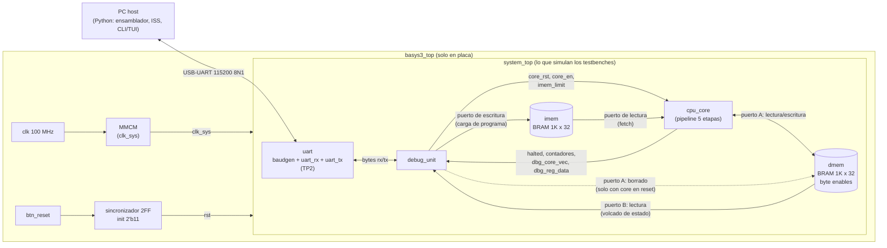
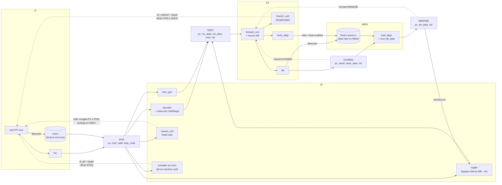

# TP3 - Arquitectura del procesador RV32I segmentado + Debug Unit

Estado: diseño revisado en la fase 0 e implementado en las fases 2-4 (el
core). La Debug Unit (fase 5) y el tope de placa (fase 7) todavía no están
implementados. El estado de cada fase está en [README.md](README.md).

Documentos relacionados:
- [modulos.md](modulos.md): lista de módulos con sus puertos.
- [protocol.md](protocol.md): protocolo UART entre la PC y la Debug Unit.
- [README.md](README.md): índice, resumen de decisiones y puntos abiertos.

Convención de este documento: cada decisión tiene la forma
**Decisión / Alternativas consideradas / Por qué**.

---

## 1. Visión general

### 1.1 Diagrama del sistema



Todo corre en **un único dominio de reloj** (`clk_sys`). El MMCM existe solo en
`basys3_top`; `system_top` y todo lo que está debajo se simula con un reloj de
testbench común, sin modelos de IP de Xilinx.

### 1.2 Diagrama del pipeline



Detalle clave del diagrama: **las BRAM se direccionan un ciclo antes** de la
etapa que consume el dato (sección 4). `imem` recibe `next_pc` y entrega la
instrucción alineada con `PC` durante IF; `dmem` recibe la dirección calculada
en EX y entrega el dato durante MEM. Así los cuatro registros de pipeline son
flip-flops explícitos.

### 1.3 Parámetros principales

| Parámetro | Valor por defecto | Comentario |
|---|---|---|
| `XLEN` | 32 | RV32I |
| `IMEM_ADDR_W` | 10 | 1024 palabras = 4 KiB = 1 RAMB36 |
| `DMEM_ADDR_W` | 10 | 1024 palabras = 4 KiB = 1 RAMB36 |
| `CLK_FREQ_HZ` | 100 000 000 | se ajusta en la fase 7 según el MMCM |
| `BAUD` | 115 200 | 8N1, igual que TP2 |
| `MAX_CYCLES` | 1 000 000 | límite de ciclos desde el reset (sección 5.4) |

El Artix-7 35T tiene 50 RAMB36, así que ambas memorias se pueden agrandar
cambiando un parámetro; 4 KiB alcanza para los programas de prueba y mantiene
corto el volcado de memoria.

### 1.4 Mapa de memoria

**Decisión (confirmada):** Harvard con dos espacios de direcciones
independientes, **ambos empezando en 0**. `lw x1, 0(x0)` lee la palabra 0 de
`dmem`; el PC 0 es la palabra 0 de `imem`. Los bits de dirección por encima
del tamaño de cada memoria se ignoran (aliasing): con 4 KiB, la dirección de
datos `0x1000` es la misma palabra que `0x0000`.

**Alternativas:** `dmem` en una base distinta (`0x1000`, o `0x10010000` como
RARS) para poder correr los mismos programas en RARS/Venus sin cambios.

**Por qué:** es lo más simple para el hardware, el ensamblador y el ISS, y el
ISS propio reemplaza a RARS como modelo de referencia. El ISS reproduce el
mismo aliasing.

---

## 2. Instrucciones y decodificación

### 2.1 Subconjunto y codificación de HALT

Se implementan exactamente las instrucciones de SPEC §2. **HALT = `ebreak`
(`0x00100073`)**.

**Alternativas:** una codificación propia en un opcode `custom-0`/`custom-1`;
`ecall`; una instrucción "inofensiva" como `jal x0, 0` (bucle a sí mismo)
detectada como HALT.

**Por qué `ebreak`:** es una instrucción estándar de RV32I que ensambladores
y simuladores existentes reconocen, y su semántica real ("detener y ceder el
control al depurador") es exactamente la nuestra. Un opcode custom obliga a
parchear cualquier herramienta externa; `jal x0, 0` mezcla un HALT con un
salto legal.

### 2.2 Instrucciones ilegales

**Decisión (confirmada):** toda instrucción fuera del subconjunto se trata
**como un HALT** con `halt_reason = ILLEGAL`: deja de buscar instrucciones,
drena el pipeline y reporta el PC de la instrucción ilegal. La decodificación
es estricta:

- opcode `[1:0]` debe ser `11`;
- opcodes válidos: OP, OP-IMM, LOAD, STORE, BRANCH, JAL, JALR, LUI, SYSTEM;
- OP: `funct7` = `0000000`, o `0100000` solo con `funct3` 000 (sub) o 101 (sra);
- OP-IMM shifts: `funct7` = `0000000` (slli, srli) o `0100000` (srai);
  `imm[5]` (bit 25) en 1 es ilegal en RV32I;
- LOAD `funct3` ∈ {000, 001, 010, 100, 101}; STORE `funct3` ∈ {000, 001, 010};
- BRANCH `funct3` ∈ {000, 001} (`blt` y similares no están en el subconjunto);
- JALR `funct3` = 000;
- SYSTEM: solo `0x00100073` exacto (`ecall` = ilegal).

**Alternativa:** ejecutarla como NOP y levantar un flag "ilegal vista".

**Por qué:** se parece más a una trampa de instrucción ilegal de RISC-V real,
y corta en seco el caso típico de un programa que salta a memoria no
programada (`0x00000000` es ilegal). Una instrucción ilegal en el camino
equivocado (después de un salto tomado) **no** detiene nada, porque se
descarta antes de aceptarse (sección 5.2).

### 2.3 Accesos desalineados (fuera del alcance; comportamiento documentado)

| Acceso | Qué hace el hardware |
|---|---|
| `lw`/`sw` | ignora `addr[1:0]`: accede a la palabra `addr & ~3` |
| `lh`/`lhu`/`sh` | ignora `addr[0]`: usa la media palabra elegida por `addr[1]` |
| `lb`/`lbu`/`sb` | siempre alineado |
| fetch con `PC[1:0] != 0` | ignora `PC[1:0]`: lee la palabra `PC & ~3`; el PC conserva sus bits bajos |

`jalr` pone `PC[0] = 0` como exige la especificación; `PC[1]` puede quedar en 1
si el programa calcula mal un destino. El ISS modela exactamente lo mismo.

### 2.4 Señales de control (salida del decoder)

| Señal | Ancho | Significado |
|---|---|---|
| `rs1`, `rs2` | 5 | **registro fuente efectivo**: 0 si la instrucción no lo usa |
| `rd` | 5 | destino (0 si no escribe) |
| `alu_op` | 4 | `{alt, funct3}` (tabla abajo) |
| `alu_src` | 1 | 0 = rs2, 1 = inmediato |
| `link` | 1 | el resultado es `pc+4` (jal, jalr) |
| `reg_write` | 1 | escribe `rd` en WB |
| `mem_read`, `mem_write` | 1 + 1 | load / store |
| `funct3` | 3 | tamaño y signo de load/store; `funct3[0]` distingue beq/bne |
| `branch` | 1 | beq/bne (se resuelve en EX) |
| `jalr` | 1 | jalr (se resuelve en EX) |
| `jal` | 1 | jal (se resuelve en ID, no viaja a EX) |
| `imm_sel` | 3 | formato del inmediato: I, S, B, U, J |
| `is_ebreak`, `illegal` | 1 + 1 | entradas de la lógica de HALT |

`rs1`/`rs2` efectivos: el decoder fuerza a 0 los campos que la instrucción no
lee (`lui`, `jal`, el `rs2` de los tipo I, `ebreak`, ilegales). Con eso la
hazard unit y la forwarding unit no ven dependencias falsas. Por ejemplo,
`ebreak` tiene `rs2 = 1` en sus bits [24:20] y sin esto frenaría detrás de un
`lw x1`. `lui` aprovecha el mismo truco: con `rs1 = x0` la ALU calcula
`0 + imm_U`, sin necesitar un mux extra.

Codificación de `alu_op = {alt, funct3}` (la natural de RISC-V):

| op | add | sub | sll | slt | sltu | xor | srl | sra | or | and |
|---|---|---|---|---|---|---|---|---|---|---|
| `alu_op` | 0000 | 1000 | 0001 | 0010 | 0011 | 0100 | 0101 | 1101 | 0110 | 0111 |

`alt` sale de `instr[30]` solo en OP (add/sub, srl/sra) y en OP-IMM con
`funct3 = 101` (srli/srai). En `addi` el bit 30 es parte del inmediato y se
ignora. Loads, stores, jalr y lui usan `add`. Los desplazamientos usan
`b[4:0]`.

---

## 3. Riesgos (hazards)

### 3.1 Riesgos de datos: forwarding hacia EX

Fuentes de forwarding hacia los dos operandos de EX, con prioridad a la más
reciente:

1. **EX/MEM** (`ex_mem.result`) si `ex_mem.reg_write && ex_mem.rd != 0 &&
   ex_mem.rd == id_ex.rsX && !ex_mem.mem_read`;
2. **MEM/WB** (`mem_wb.wb_data`) si `mem_wb.reg_write && mem_wb.rd != 0 &&
   mem_wb.rd == id_ex.rsX`;
3. si no, el valor leído del banco en ID (`id_ex.rsX_data`).

El valor de rs2 ya forwardeado se usa tanto para la ALU como para el dato de
store y para el comparador de saltos.

`!ex_mem.mem_read` es defensivo: por construcción un load nunca está en MEM con
un consumidor en EX (lo impide el stall de 3.2). Los testbenches de la fase 3
verifican que esa condición nunca se da.

**WB → ID:** el banco de registros tiene **bypass interno**: si en el mismo
ciclo se escribe `rd` y se lee `rs == rd` (con `rd != 0`), la lectura devuelve
el dato que se está escribiendo.

**Alternativas para WB→ID:** escribir el banco en el flanco descendente
("primera mitad del ciclo"), como en el libro de Patterson & Hennessy.

**Por qué el bypass:** usar el flanco descendente parte el ciclo a la mitad
para el camino WB→banco, agrega un segundo flanco al diseño y roza la regla de
"no intervenir el reloj". El bypass es un mux 2:1 por puerto de lectura, todo
en el flanco ascendente.

### 3.2 Load-use: un ciclo de stall

`load_use = if_id.valid && id_ex.mem_read && id_ex.rd != 0 &&
(id_ex.rd == id.rs1 || id_ex.rd == id.rs2)`, con `rs1`/`rs2` efectivos.

Efecto: se congelan el PC y el IF/ID, y se inserta una burbuja en ID/EX. Un
ciclo después el load está en WB y el consumidor en EX toma el dato por
forwarding desde MEM/WB.

```
ciclo        1    2    3    4    5    6    7
lw  x1,0(x2) IF   ID   EX   MEM  WB
add x3,x1,x4      IF   ID   ID*  EX   MEM  WB     * stall; en 5 forward MEM/WB->EX
siguiente              IF   IF*  ID   EX   MEM
```

Incluye `lw x1; sw x1, 0(x2)` (rs2 del store) y `lw x1; beq x1, ...`.

**Alternativas:** forwarding MEM→EX directo desde la salida de la BRAM (sin
stall), o forwarding MEM→MEM para el caso load→store.

**Por qué:** SPEC exige el stall de 1 ciclo. Además, poner la salida de la
BRAM (tiempo clock-to-out alto, ~2 ns en Artix-7 -1) en el camino de
forwarding hacia la ALU alargaría el camino crítico. Con el stall, el
forwarding sale siempre de flip-flops.

### 3.3 Riesgos de control

**Decisión:**
- `beq`, `bne` y `jalr` se resuelven en **EX**, con predicción estática "no
  tomado". Si el salto se toma, se vacían IF/ID e ID/EX (**2 ciclos** de
  penalidad).
- `jal` se resuelve en **ID** (su destino `pc + imm_J` no depende de
  registros). Se vacía solo IF/ID (**1 ciclo** de penalidad).

```
ciclo          1    2    3    4    5    6
beq (tomado)   IF   ID   EX   MEM  WB
pc+4                IF   ID   --              (flush)
pc+8                     IF   --              (flush)
destino                       IF   ID   EX

jal            IF   ID   EX   MEM  WB         (rd = pc+4 se calcula en EX)
pc+4                IF   --                   (flush)
destino                  IF   ID   EX
```

El comparador de igualdad del `branch_unit` es dedicado y opera sobre los
operandos ya forwardeados, en paralelo con la ALU. El destino de `beq`/`bne`
es `id_ex.pc + id_ex.imm`, calculado con un sumador propio en EX a partir de
flip-flops, fuera del camino crítico. El de `jalr` es
`(alu_result) & ~1`, porque la ALU ya calcula `rs1 + imm`.

**Alternativas consideradas:**

| Opción | Penalidad (tomado) | Costo |
|---|---|---|
| Todo en EX (incluido jal) | 2 | la más simple |
| **beq/bne/jalr en EX, jal en ID** (elegida) | 2 / 1 jal | un sumador y un redirect más en ID |
| beq/bne en ID con comparador | 1 | forwarding hacia ID, stall de 1 ciclo si el operando lo produce una ALU en EX y de 2 si es un load; comparador después del mux de forwarding en ID |
| Predicción dinámica (BTB/BHT) | ~0 si acierta | mucho hardware, fuera de alcance |
| Delay slot | 0 | no es semántica RISC-V: rompería el ensamblador y el ISS |

**Por qué:** resolver beq/bne en ID ahorra 1 ciclo por salto tomado pero
agrega una segunda red de forwarding (hacia ID), dos casos nuevos de stall y
un camino largo en ID (lectura del banco + bypass + forwarding + comparador +
mux del PC). En EX se reutiliza la forwarding unit existente y el riesgo de
control queda aislado en un solo lugar. `jal` es la excepción barata: no lee
registros, así que resolverlo en ID no necesita forwarding ni stalls y ahorra
un ciclo en cada llamada.

**Ciclos esperados** (útiles para los tests de la fase 3), contando desde el
primer ciclo habilitado tras el reset hasta que se levanta `halted`:

```
ciclos = N + 4 + stalls_load_use + 2*(beq/bne tomados + jalr) + 1*jal
```

`N` es la cantidad dinámica de instrucciones ejecutadas, incluyendo el
`ebreak`. Ejemplo: `addi x1,x0,5; ebreak` → N = 2 → 6 ciclos.

### 3.4 Prioridades entre eventos en un mismo ciclo

| Prioridad | Evento | PC | IF/ID | ID/EX |
|---|---|---|---|---|
| 1 | `rst` | 0 | burbuja | burbuja |
| 2 | `!en` (pausa/step) o `halted` | se mantiene | se mantiene | se mantiene |
| 3 | `ex_redirect` (salto tomado o jalr en EX) | destino EX | burbuja | burbuja |
| 4 | `halt_accept` (HALT aceptado en ID) | `if_id.pc` | burbuja | marcador HALT |
| 5 | `halting` (drenando) | se mantiene | burbuja | burbuja* |
| 6 | `load_use` | se mantiene | se mantiene | burbuja |
| 7 | `id_jal` | destino jal | burbuja | se carga (jal) |
| 8 | normal | `pc+4` | `{PC, imem_dout}` | se carga* |

\* **Burbuja heredada:** si el IF/ID contiene una burbuja (`if_id.valid = 0`),
el ID/EX también recibe una burbuja en vez de decodificarla. Pasa siempre
mientras se drena, y en el ciclo siguiente a cualquier flush del IF/ID.

Por eso el flush del ID/EX tiene tres términos:

```
id_ex_flush = ex_redirect | load_use | !if_id.valid
```

El tercer término no cambia lo que calcula el procesador. La burbuja del
IF/ID es una NOP (`addi x0, x0, 0`), que el decoder ya convierte en una
instrucción sin efectos (`reg_write = 0` porque rd = x0). Pero si se
decodificara, quedaría con `alu_src = 1`. Con el flush, toda burbuja del ID/EX
tiene todos los bits de control en 0, sin importar cómo se generó, que es lo
que promete el volcado de estado (protocol.md §6.2) y lo que la TUI necesita
para mostrar etapas vacías.

Combinaciones imposibles, que simplifican la lógica:
- `load_use` y `ex_redirect` son excluyentes: el primero exige un load en EX
  y el segundo un salto en EX.
- `load_use` con `halt_accept` o con `id_jal` tampoco ocurre: HALT, ilegal y
  jal tienen `rs1 = rs2 = 0`.

EX/MEM y MEM/WB nunca se congelan ni se vacían por riesgos; solo los afectan
`rst` y `en`.

### 3.5 Riesgo estructural

Memorias de instrucciones y datos separadas (Harvard), cada una en su propia
BRAM. El banco de registros tiene dos puertos de lectura y uno de escritura
(más un puerto de lectura para debug). No hay recursos compartidos entre
etapas.

---

## 4. Memorias y latencia de BRAM

### 4.1 Memoria inferida y no IP

**Decisión:** BRAM **inferida** en Verilog puro (plantillas de Xilinx UG901),
sin Block Memory Generator.

**Alternativas:** IP Block Memory Generator con archivo `.coe`; memoria
distribuida (LUTRAM) con lectura asíncrona.

**Por qué:**
- La memoria inferida simula con `xvlog` sin compilar modelos de IP ni
  librerías de simulación (`sim.bat` funciona tal cual).
- Es parametrizable (`ADDR_W`) y se inicializa con `$readmemh` desde un
  parámetro.
- No agrega archivos `.xci` dependientes de la versión de Vivado al repo.
- El IP solo aportaría opciones que no usamos (ECC, registro de salida
  configurado a mano, más de dos puertos).

En la fase 7 se verifica en el reporte de utilización que Vivado haya inferido
`RAMB36E1` y no LUTRAM.

LUTRAM (lectura asíncrona) permitiría un pipeline "de libro", sin pensar en la
latencia. A cambio, 2 × 4 KiB consumen ~1000 LUTs más multiplexores, son más
lentas a este tamaño y no escalan. SPEC sugiere BRAM.

### 4.2 Cómo se absorbe la lectura síncrona

**Decisión:** cada BRAM se direcciona **un ciclo antes** de la etapa que
consume el dato, y todos los registros de pipeline son flip-flops explícitos.

- **imem (IF):** la dirección es `next_pc` (la salida combinacional del mux
  del PC). En el flanco, `PC <= next_pc` y la BRAM lee `imem[next_pc]`. Así,
  durante IF, `imem_dout = imem[PC]`, y en el flanco siguiente IF/ID captura
  `{PC, imem_dout}`.
  - En stall o pausa, `next_pc = PC`: la BRAM relee la misma dirección y el
    dato se mantiene.
  - En reset, `next_pc = 0`: al salir del reset, `imem[0]` ya está disponible.
  - El flush pone el IF/ID en burbuja directamente: es un registro común.
- **dmem (EX→MEM):** la dirección es el resultado de la ALU en EX
  (combinacional). En el flanco EX→MEM, la BRAM lee esa dirección (y, si es un
  store, escribe con byte enables). Durante MEM el dato está en `dmem_dout`;
  `load_align` lo recorta y extiende, se elige `wb_data` y MEM/WB lo captura
  en flip-flops.
  - Consecuencia: **el store se escribe al final de EX**, no al final de MEM.
    Es seguro porque una instrucción que está en EX nunca se cancela: los
    flush solo matan instrucciones más jóvenes (IF e ID), el HALT deja
    terminar a las más viejas, y el stall de load-use mete la burbuja en
    ID/EX sin tocar EX. Durante la pausa la escritura está bloqueada por `en`.
  - El enable de lectura del puerto A es `en`: en pausa, el dato de un load
    que está en MEM se mantiene.

**Alternativas consideradas:**

| Opción | Ventaja | Desventaja |
|---|---|---|
| **Direccionar un ciclo antes** (elegida) | registros de pipeline explícitos; MEM/WB con dato en FF; forwarding siempre desde FF | el camino crítico de EX termina en los pines de dirección de las BRAM (setup de BRAM > setup de FF) |
| Usar el latch de salida de la BRAM *como* registro de pipeline (dirección = PC / `ex_mem.result`) | caminos de entrada más cortos | IF/ID.instr y el dato de MEM/WB quedan "dentro" de la BRAM: el flush necesita un bit `valid` y un mux a NOP; el forwarding desde WB arranca en el clock-to-out de la BRAM (camino largo); leer la dmem por el mismo puerto para debug pisa el estado del pipeline |
| PC como dirección y aceptar 1 ciclo extra (IF en 2 ciclos) | trivial | pipeline de 6 etapas, más penalidad en saltos |
| BRAM en flanco descendente | parece asíncrona | usa el flanco opuesto, divide el ciclo en dos y va contra la regla de reloj |
| LUTRAM asíncrona | "de libro" | ver 4.1 |

**Por qué:** cumple SPEC §3 al pie de la letra ("BRAM with the address taken
from next-PC") y deja los cuatro registros de pipeline como flip-flops reales,
fáciles de resetear, vaciar y leer desde la Debug Unit. La desventaja (setup
de la BRAM al final del camino de EX) se mide en la fase 7.

### 4.3 Puertos de cada memoria

| Memoria | Puerto A | Puerto B | Recursos |
|---|---|---|---|
| `imem` | escritura, solo la Debug Unit (carga de programa, con el core en reset) | lectura, solo el core (fetch, dirección `next_pc`) | 1 RAMB36, simple dual port |
| `dmem` | lectura/escritura, el core (byte enables) o la Debug Unit para el borrado, multiplexados en `system_top` y solo con el core en reset | lectura, solo la Debug Unit (volcado) | 1 RAMB36, true dual port con B solo lectura |

Regla de CLAUDE.md: "no asignar la misma variable desde más de un bloque". El
arreglo de memoria se escribe en **un solo** `always` (el del puerto A). El
`always` del puerto B solo lee y asigna únicamente su propio registro de
salida. Vivado infiere true dual port igual.

Leer la dmem por el puerto B (y no por el del core) es lo que permite volcar
la memoria en modo step **sin pisar** el dato de un load que está en MEM.

### 4.4 "Memoria usada" (SPEC §5.4)

**Decisión:** *high-water mark* por palabra: la Debug Unit espía las
escrituras del core en el puerto A y mantiene
`dmem_used = max(dmem_used, addr_palabra + 1)`. El volcado envía las palabras
`[0, dmem_used)`. Se pone en 0 con RESET y LOAD.

**Alternativas:** un bit "escrita" por palabra (bitmap de 1024 bits) y enviar
solo esas palabras con su dirección; enviar siempre los 4 KiB; un rango
`[min, max]`.

**Por qué:** el contador es un único registro con un comparador, y el
protocolo sigue siendo un bloque contiguo sin direcciones. El bitmap necesita
otra memoria y un formato con direcciones; enviar todo cuesta ~0,36 s por
volcado a 115200, lo que molesta en modo step. Limitación conocida: un
programa que escribe solo en una dirección alta provoca un volcado grande.

### 4.5 Contenido inicial

- `imem`: parámetro opcional `INIT_FILE` (`$readmemh`) con programa por
  defecto, y `INIT_LEN` (palabras) como valor inicial de `prog_len`. Por
  defecto `INIT_LEN = 0`: no hay programa hasta el primer LOAD.
- `dmem`: ceros (valor de bitstream), y se borra en cada reset de la Debug
  Unit (sección 6.3).
- Banco de registros: flip-flops con reset síncrono a 0.
- Rutas de `$readmemh` en simulación: los archivos se copian o generan en
  el directorio de build antes de simular (verificacion.md §2).

---

## 5. HALT y drenaje del pipeline

### 5.1 Fuentes de detención

| Código `halt_reason` | Nombre | Origen |
|---|---|---|
| 0 | NONE | no se detuvo |
| 1 | HALT | `ebreak` decodificado en ID |
| 2 | ILLEGAL | instrucción ilegal decodificada en ID |
| 3 | OOR | fetch con `PC >= 4*prog_len` (PC fuera del programa cargado) |
| 4 | TIMEOUT | `cycle_cnt >= MAX_CYCLES` (límite de ciclos) |

Todas usan **el mismo mecanismo**: un "slot de detención" que entra a ID y se
acepta como si fuera un `ebreak`.

- HALT e ILLEGAL salen de la instrucción misma.
- OOR y TIMEOUT marcan la instrucción que se está buscando en IF: IF/ID
  guarda un `stop_code` de 3 bits junto con la instrucción, con prioridad
  TIMEOUT > OOR. La instrucción de memoria de ese slot nunca se ejecuta.
- Las dos condiciones se calculan dentro del core en cada fetch: OOR con
  `imem_limit` y TIMEOUT con `cycle_cnt`. La Debug Unit no interviene.

### 5.2 Aceptación en ID

```
halt_cond   = if_id.stop_code != 0 || is_ebreak || illegal
halt_accept = if_id.valid && halt_cond && !ex_redirect && en && !halting
```

- **`!ex_redirect`:** si en EX hay un salto tomado, el slot de ID está en el
  camino equivocado y se descarta. Un `ebreak` o una ilegal después de un
  `beq` tomado no detiene nada. Para OOR y TIMEOUT, el `stop_code` se vuelve
  a marcar en el siguiente fetch, porque las dos condiciones se recalculan en
  cada ciclo.
- Cuando `halt_cond` es verdadero, el decoder anula todas las señales de
  control (`rs1 = rs2 = 0`, sin escrituras), así que el slot nunca dispara un
  stall.

Al aceptar, en el mismo flanco:
1. `halting <= 1`, `halt_reason <= motivo`.
2. ID/EX recibe un **marcador HALT**: `valid = 1`, `is_halt = 1`, `pc =
   if_id.pc`, ninguna escritura. Viaja por EX y MEM como una NOP visible.
3. `PC <= if_id.pc`: el PC final queda apuntando a la instrucción que provocó
   la detención (el `ebreak`, la ilegal o la primera instrucción no
   ejecutada). Es la convención estándar: en RISC-V, una trampa por `ebreak`
   guarda en `mepc` la dirección del propio `ebreak`, y un depurador como GDB
   muestra el PC parado sobre la instrucción de breakpoint.
4. IF/ID pasa a burbuja y, mientras `halting = 1`, recibe solo burbujas; el
   PC queda fijo.

### 5.3 Fin del drenaje

Las instrucciones más viejas que el HALT ya están en EX/MEM y MEM/WB y
siguen su curso normal. Ninguna puede cancelarse: un HALT aceptado implica
que no había salto tomado en EX, y detrás del marcador no hay nada.

`halted <= 1` (y `halting <= 0`) en el flanco en que el marcador **sale** de
MEM/WB. En ese mismo flanco MEM/WB recibe la burbuja que viene de EX/MEM.
Resultado:

> **Invariante: `halted = 1` ⇒ IF/ID, ID/EX, EX/MEM y MEM/WB contienen
> burbujas**, todas las instrucciones anteriores al HALT escribieron su
> resultado y ninguna posterior tuvo efecto.

```
ciclo          t     t+1   t+2   t+3   t+4
i-3            WB
i-2            MEM   WB
i-1            EX    MEM   WB
ebreak (i)     ID*   EX    MEM   WB    (sale)   * halt_accept
i+1            IF    --                         (burbuja)
halted                                  1
```

Desde que el HALT llega a ID hasta `halted` pasan 4 ciclos habilitados. En
modo step el host lo ve paso a paso: en el volcado de t+3 el marcador está en
WB y en el de t+4 el pipeline está vacío con `halted = 1`.

Una vez en `halted`, el core ignora `en`. Solo un RESET o un LOAD lo sacan de
ese estado. No hay "continuar después de HALT": SPEC lo define como fin de
ejecución.

**Alternativas consideradas:**
- **Contador de drenaje:** al ver HALT en ID, contar 3 ciclos sin buscar
  instrucciones. Es equivalente, pero no deja ver el HALT avanzando por las
  etapas y separa la lógica de la del pipeline.
- **Levantar `halted` cuando el HALT llega a WB**, dejándolo dentro de
  MEM/WB. Ahorra un ciclo, pero el pipeline no queda literalmente vacío.
- **Congelar con el HALT en ID** sin dejar pasar el marcador. Las
  instrucciones viejas igual necesitan avanzar, así que hace falta un enable
  por etapa: más complejo.

**Por qué:** el marcador reutiliza el mismo avance del pipeline, no tiene
casos especiales por etapa, cumple "pipeline vacío" literalmente y se ve en
los volcados paso a paso.

### 5.4 Programas sin HALT (pregunta 8.5)

Dos salvaguardas independientes:

1. **OOR:** la Debug Unit conoce `prog_len` (palabras cargadas) y se lo pasa
   al core como `imem_limit`. Un fetch con `PC >= 4*prog_len` se convierte en
   slot de detención. Cubre el caso típico de "se cae del final del programa"
   y los saltos fuera del programa. Respeta los saltos: un fetch fuera de
   rango en el camino equivocado se descarta. Sin programa cargado
   (`prog_len = 0`), el primer fetch ya es OOR.
2. **TIMEOUT:** un contador de ciclos habilitados `cycle_cnt` de 32 bits.
   Cuando `cycle_cnt >= MAX_CYCLES` (parámetro, por defecto 1 000 000 =
   10 ms a 100 MHz), el siguiente fetch se convierte en slot de detención.
   Cubre los bucles infinitos dentro del programa. Los programas de prueba
   duran cientos de ciclos, así que el margen es enorme; los testbenches
   pueden bajar el parámetro para probar el TIMEOUT rápido.

En los dos casos el resultado es el mismo que con un `ebreak`: drenaje,
pipeline vacío, `halted` y volcado, con el motivo en `halt_reason`. Además,
garantizan que **todo RUN termina**, así que el protocolo no necesita un
comando para interrumpirlo.

**Alternativas:** solo timeout; rellenar la imem sobrante con `ebreak` al
cargar (no cubre saltos fuera de rango y obliga a escribir toda la memoria en
cada LOAD); que el ensamblador agregue un `ebreak` al final (depende del host;
el hardware tiene que defenderse solo); detectar "PC llega al final de la
memoria física" (con 4 KiB y aliasing, el PC nunca "llega al final").

---

## 6. Enable global, modo step y reset (sin tocar el reloj)

### 6.1 Enable global

**Decisión:** el core tiene una entrada `en`. La Debug Unit la maneja así:

```
core_en = running || step_pulse
```

- `running` vale 1 desde un RUN hasta que se ve `halted`.
- `step_pulse` dura exactamente 1 ciclo de reloj por comando STEP.

Dentro del core: `en_int = en && !halted`, y todo elemento secuencial del
core usa la forma

```verilog
always @(posedge clk) begin
  if (rst)          begin ... end
  else if (en_int)  begin ... end
end
```

**Qué queda bajo `en_int`:**
- el PC y los cuatro registros de pipeline;
- la escritura del banco de registros;
- la escritura de dmem (`we = en_int & mem_write`);
- el enable de lectura de dmem (para mantener `dmem_dout`);
- el estado de HALT (`halting`, `halted`, `halt_reason`);
- el contador `cycle_cnt`.

La lectura de imem no necesita enable: con `en_int = 0` vale `next_pc = PC` y
la BRAM relee la misma palabra.

**Qué queda fuera:** la UART, la Debug Unit y el borrado de dmem. Corren
siempre.

**Por qué no gating del reloj (BUFGCE o lógica en el reloj):** SPEC §4 lo
prohíbe. Además, en FPGA el enable es gratis: cada flip-flop del slice tiene un
pin CE (FDRE con R síncrono prioritario sobre CE, exactamente lo que modela
`if (rst) ... else if (en)`), y las BRAM tienen sus propios pines de enable.
Un reloj gateado con lógica generaría skew y glitches y obligaría a otro
dominio de reloj.

### 6.2 Modo step

Un STEP produce un `step_pulse` de 1 ciclo, que equivale a **exactamente un
flanco habilitado**. En el ciclo siguiente la Debug Unit empieza a enviar el
volcado; el core ya está congelado (`core_en = 0`), así que el estado es
estable mientras se transmite. Si `halted` ya vale 1, STEP responde
`ERR_HALTED` y no avanza nada.

**Propiedad clave:** el core ve la misma secuencia de flancos habilitados en
modo continuo y en modo step. Por lo tanto el estado tras *k* pasos es
idéntico al estado tras *k* ciclos de ejecución continua, incluidos stalls,
flushes y contadores. Se puede mezclar: avanzar unos pasos y después RUN.
`tb_cpu_step` lo verifica ciclo a ciclo con todos los programas de prueba
(verificacion.md §5).

**Alternativas:** step por instrucción (avanzar hasta que se retire una
instrucción): SPEC pide explícitamente un ciclo por comando. Step con conteo N
en un solo comando: se puede agregar después sin cambiar el formato del
volcado; por ahora STEP es siempre 1 ciclo.

### 6.3 Resets

| Reset | Origen | Qué reinicia |
|---|---|---|
| `rst` de placa | botón (2FF, init `2'b11`) o MMCM sin lock | todo: UART, Debug Unit, core |
| `core_rst` | Debug Unit (comandos RESET y LOAD, y tras `rst`) | PC = 0, registros de pipeline en burbuja, banco de registros en 0, `halting`/`halted`/`halt_reason`, `cycle_cnt` |

Mientras `core_rst` está activo, la Debug Unit puede escribir imem (LOAD) y
borra la dmem recorriendo sus 1024 palabras por el puerto A (~10 µs a
100 MHz, menos que el tiempo de un byte de UART). Libera `core_rst` como
mínimo 2 ciclos después de la última escritura en imem, para que la lectura
de `imem[0]` sea la nueva y no una colisión lectura/escritura.

**¿Por qué borrar dmem y registros en cada RESET?** Para que cada ejecución
sea reproducible y coincida con el ISS, que arranca de todo en cero. También
hace que el high-water mark tenga sentido. La imem no se borra: LOAD la
sobrescribe y `prog_len` (OOR) evita ejecutar restos de un programa anterior.
Esto anticipa las respuestas a las preguntas 8.1-8.4.

---

## 7. Lectura del estado por la Debug Unit

Con el core congelado, todo el estado es estable y se lee
combinacionalmente:

- **Registros de pipeline y PC:** el core expone `dbg_core_vec[511:0]`, la
  concatenación del PC y de los cuatro registros de pipeline en el orden y con
  los campos exactos de protocol.md §6 (64 bytes). La Debug Unit selecciona un
  byte con un índice: un mux de 64:1 × 8 bits, barato.
- **Banco de registros:** un tercer puerto de lectura asíncrono
  (`dbg_reg_addr` → `dbg_reg_data`).
- **dmem:** puerto B, 1 ciclo de latencia, sin interferir con el pipeline.

**Alternativas:** una cadena de scan (shift register) que serializa todo el
estado. Usa menos mux, pero agrega un registro por bit y un modo de
desplazamiento que toca los registros reales. También se consideró leer los
registros por los puertos rs1/rs2 del core, lo que obliga a multiplexar las
direcciones del decoder y alarga ID.

**Por qué:** el mux por byte no modifica el estado, cuesta pocos cientos de
LUTs y el formato queda definido en un solo lugar (protocol.md).

Banco de registros en flip-flops, no en LUTRAM: con 3 puertos de lectura más
el reset síncrono, la LUTRAM necesitaría 3 copias y un borrado por barrido.
Con flip-flops son 1024 FFs (de 41 600 disponibles) y ~3 mux 32:1 × 32 bits.

---

## 8. Reuso de TPs anteriores

| Origen | Uso en TP3 |
|---|---|
| `TP2/src/uart_baudgen.v`, `uart_rx.v`, `uart_tx.v`, `uart.v` | se copian **sin cambios**. Divisor entero: a 100 MHz, DIV = 54, error de baudios +0,47 %. Si en la fase 7 el MMCM cambia la frecuencia, se recalcula el error; con más de ~2 % se cambia a un divisor fraccional (acumulador). |
| `TP2/src/basys3_uart_alu.v` | se reutiliza el patrón de sincronizador de reset y el manejo de `tx_busy` (que sube un ciclo después de `tx_start`) |
| `TP2/py/*.py` | base de pyserial para la CLI (abrir puerto, `reset_input_buffer`, timeouts) |
| `TP1/src/myALU.v` (SPEC lo llama `my_ALU.v`) | **no se reutiliza tal cual**: es de 8 bits, registra sus operandos internamente, usa opcodes estilo MIPS y le faltan sll, slt y sltu. Se reutiliza la idea (case por operación, `$signed` para sra) en una ALU combinacional nueva de 32 bits. |
| `TP1/constrs/basys3.xdc`, `TP2/constrs/const.xdc` | base para `TP3/constrs/` (reloj W5, botón U18, UART B18/A18, LEDs); sin cambiar pines |
| `TP3/src/*`, `TP3/sim/*` (intento anterior) | **se descartan**: core monolítico, memorias asíncronas, sin saltos, solo add/sub/addi/lw/sw, banco sin bypass WB→ID (lee datos viejos) y load-use que mira campos rs que la instrucción no usa. Se borran al empezar la fase 2 para que `sim.bat` no los compile. |
